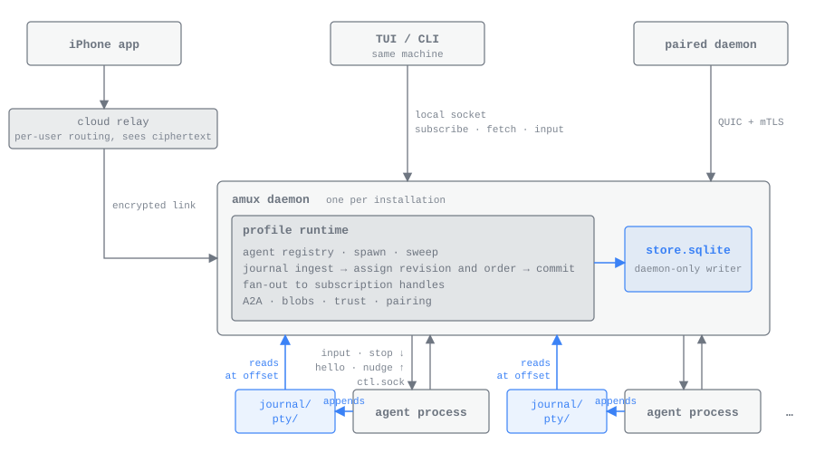
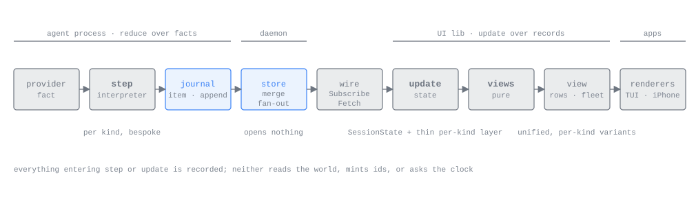
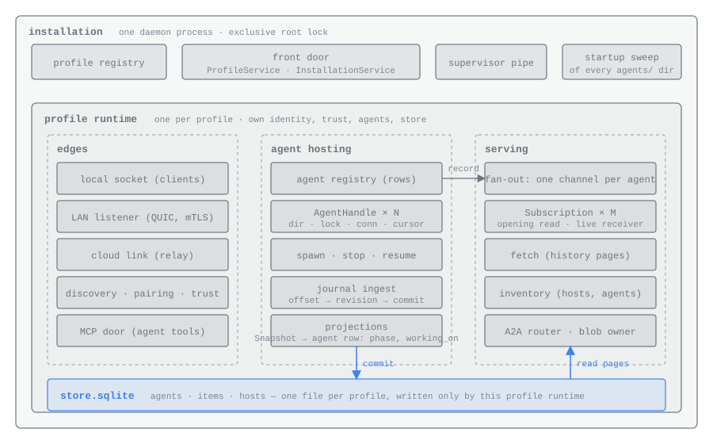
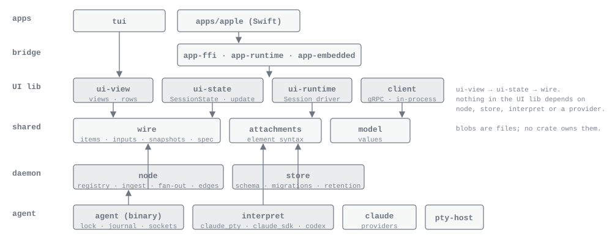

# Architecture

*For developers who need the whole system in their head before changing any part of it.*

This page is the map. It states what amux has to get right, names the
pieces, and shows how data moves between them. Each subsystem has its own
page for depth: the [agent process](AGENT_PROCESS.md), the
[interpreters](INTERPRETERS.md), the [journal and store](JOURNAL_AND_STORE.md),
the [wire](WIRE.md), the [link protocol](PROTOCOL.md),
[attachments](ATTACHMENTS.md), [agent tools](AGENT_TOOLS.md), the
[supervisor](SUPERVISOR.md) and the [client](CLIENT.md).

## Problem and goals

amux runs coding agents of several kinds (Claude Code in a terminal,
headless Claude Code over its stream-JSON interface, Codex over its app
server) on one or more machines, and shows them to clients that are equal
peers: the terminal client, the iPhone app, and any desktop app to come.
Machines pair with each other, update independently, crash independently,
and reach each other directly, over SSH or through a relay.

What the design holds itself to:

1. **A daemon crash or update never interrupts an agent's work.** An agent
   keeps working while a daemon comes back; only when none does may it stop,
   and then only at the end of a turn.
2. **Provider output is interpreted once, at the source,** into
   self-contained items any client can draw without knowing the provider.
3. **A client opens a chat with "the last N items"** and pages older
   history only if it needs it. There is no replay protocol.
4. **Every surface tolerates version skew by field discipline,** because
   paired machines, pinned agent processes and long-lived clients never
   update together; from 0.9.0 `just proto-compat` holds the protocol to it
   against the latest release ([the wire](WIRE.md#compatibility)).
5. **Lean on the operating system.** Files, file locks, sockets closing on
   process death and inodes surviving a binary swap do the work before any
   protocol does.
6. **Every client is an equal client,** and every behaviour is judged by
   how it reads from a phone that has just opened.

Out of scope: Windows parity (its costs are listed
[below](#windows-as-a-stated-cost)), semantic search, the daemon scheduling
or chaining agents (coordination is the agents' own job, through their
tools, or the person's), and remote raw terminals: a remote agent is a chat.

## Vocabulary

| Word | Meaning | Not to be confused with |
|---|---|---|
| **installation** | One data directory and the one daemon that holds its lock. It hosts any number of profiles. | a profile |
| **profile** | A complete amux inside an installation: its own host id, key, trust store, agents and store. One per account, plus unbound ones. | a user account |
| **host** | A profile as other machines see it, named by its host id. The phone is a host too; it runs no agents. | a machine |
| **agent** | One provider session hosted by one agent process, with a UUID that is amux's own and survives resume and `/clear`. | the provider's session id |
| **incarnation** | One run of an agent's process, started from one `spec.<n>` file. Resume starts the next incarnation. | a restart of the same process |
| **fact** | The provider's own data: a transcript row, a hook payload, a stream-JSON event, an app-server notification. Never leaves the agent process. | item |
| **interpreter** | The per-kind state machine in the agent process: a fact, an input or a tick in; a journal step and effects out. Pure. | a parser |
| **item** | A keyed, self-contained unit of a transcript, sent in full every time it is revised. | a row, an event |
| **append** | A revision that only adds text to one field of an item: the single kind of delta. | a patch |
| **snapshot** | The interpreter's current agent state: a kind-neutral envelope (queue, phase, what it is working on) and a per-kind body. Replaced whole. | the inventory row |
| **key** | The provider-derived identity of an item (a tool call id, a message uuid, a Codex item id). Opaque; carries no order. | a row id |
| **revision** | A per-agent integer the owning daemon assigns at commit. Answers "what changed since?" for a replica following its origin. Clients never see one. | order |
| **order** | An item's transcript position, assigned when its key is first committed and never changed. Answers "where does this sit?"; history is paged by it. | revision |
| **own / replica** | Rows for agents this profile hosts (truth) against rows copied from a paired host (a cache). | — |
| **source** | What feeds an agent's rows into a store: its journal for an own agent, one subscription to the origin for a replica. | — |
| **blob** | Content-addressed bytes (hash, MIME type, size) in an agent's directory. An attachment references one and carries its role and name. | — |
| **view** | A pure function of the client model returning content values: rows, cards, the fleet. Clients compose views; the view library never draws. | a screen |

## The mental model



Structured data moves one way. An agent process appends records to its
journal; the daemon ingests them into its profile's store and fans each
committed record out to the clients subscribed to that agent; a client
reduces the records into its model and draws views of it. Nothing flows
back along that path except inputs, which the daemon forwards to the agent
over its control socket and the interpreter answers with a verdict.

Raw terminal bytes take a second path that never touches the daemon. The
agent writes them to `pty/` in its directory and serves `pty.sock`; a
terminal client on the same machine derives the directory by convention and
connects directly (`amux attach`). No terminal byte crosses the network.

There are two reduce loops with one contract between them. The interpreter
reduces provider facts into records. The UI reduces records into a model.
The daemon between them stores and forwards records and never opens a
per-kind body.



The principles that follow from that picture:

- **The daemon interprets nothing.** Item and snapshot bodies are bytes to
  it. The one exception is the debug-bundle path, which links `interpret`
  for its per-kind redactor.
- **Commit before fan-out.** A client never sees a revision the store
  cannot serve, so catching up and going live join at one point.
- **Full state per revision.** Items are complete every time they are sent,
  except live appends to one text field, so a late arrival never needs a
  replay protocol.
- **Pure functions with recorded inputs.** The interpreter's step, the
  model's update and every view read nothing from the world: ids, time and
  randomness arrive as inputs. That is what makes every layer replayable
  from a [debug bundle](DEBUGGING.md).
- **Ask the operating system first.** Existence is a directory, liveness is
  a held file lock, "the peer went away" is end of file on a socket. A
  protocol earns its place only where the kernel has no answer.
- **A core is a function of its inputs.** The daemon, the relay, the agent
  process and the supervisor each decide everything in one `step`: a typed
  input in, typed outputs appended, with no lock, task or await inside.
  Sockets, codecs, timers and disk belong to a driver around the core,
  which decodes what arrives into inputs and carries out the outputs. What
  only produces a result, such as an fsync or a token refresh, is a job the
  driver runs and reports back as an input.
- **The properties are the protocol spec.** Every promise the protocol
  makes is written once, as a sentence and a predicate over a core's state,
  in [`models`](../crates/models/README.md). A checker explores the real
  cores against them under `just test`. The code is the only
  implementation of a rule; a test that restates a rule a property already
  holds is a second copy, and goes.
- **A seed reproduces a run.** Nothing in a core reads the clock, the
  network or a random source, so a run is decided by its inputs, and a
  simulated run's inputs are decided by its seed. A failure is reported as
  the seed that produced it, and that seed alone replays it.
- **An invariant violation produces a dump, and a dump replays.** The cheap
  invariants are checked inside `step` in production, and a violation
  emits a dump with the violation as its reason instead of carrying on. A
  dump is, for each stage, a checkpoint and the inputs since, so replaying
  it re-runs the stage with every property checked and stops at the step
  that broke one.

## Processes

On a desktop, four kinds of process run, each with one job:

| Process | Started as | Job |
|---|---|---|
| **supervisor** | `amux supervise`, by the login item or `amux server start` | Parent of the daemon: restarts it whenever it exits and, under `updates = "auto"`, installs releases. See [the supervisor](SUPERVISOR.md). |
| **daemon** | `amux daemon`, by the supervisor (or by a service manager on a host without one) | The installation: every profile runtime, their stores, network edges and client sockets. |
| **agent process** | `amux internal agent <dir>`, by the daemon, detached into its own process group | One agent: holds its directory's lock, runs the provider child and the interpreter, writes the journal. See [the agent process](AGENT_PROCESS.md). |
| **provider child** | by the agent process | `claude` on a pseudo-terminal, `claude` speaking stream-JSON on stdio, or `codex app-server` on stdio. |

Two small helpers run on the provider's behalf, from the installed `amux`
binary: `amux internal mcp <dir>`, the tool server the provider launches for amux's
[agent tools](AGENT_TOOLS.md), and `amux internal hook claude`, the command terminal
Claude runs for each hook event, which forwards the payload to the agent's
`private/hooks.sock`.

The cloud relay is the same binary run as `amux relay`. It is
not an installation: no profiles, no agents, no supervisor.

On the phone, the app hosts the daemon's profile runtime inside its own
process ([`app-embedded`](../crates/app-embedded/src/lib.rs)), one profile
per account. It runs no agents; to the machines it pairs with it is a host
like any other, with its own identity, trust and store of replica rows.

Clients never talk to agent processes, and agent processes never talk to
clients: the journal and the control socket are an agent's only interface.

### Each process is a core and its driver

Four of these processes decide what they do in a state-machine core, and
everything else in them is the core's driver. Inside the daemon, and the
relay, a second kind of core decides one thing per peer:

| Process | Core | Driver | What the driver holds |
|---|---|---|---|
| daemon | [`daemon-core`](../crates/daemon-core/README.md), one per profile | [`node::driver`](../crates/node/src/driver/mod.rs) | the profile's sockets, links, channels and calls in flight, its timers and the jobs it runs |
| relay | [`relay-core`](../crates/relay-core/README.md) | [`node`'s relay server](../crates/node/src/edge/relay_server.rs) and its [forwarder](../crates/node/src/link/forwarder.rs) | accepted links, the pair table and the hold buffer for senders not yet admitted |
| daemon, per peer | [`path-core`](../crates/path-core/README.md), one per peer of a profile | [`node::link::paths`](../crates/node/src/link/paths.rs) | the profile's one link socket, the probes in flight and the route each peer's packets take |
| agent process | [`agent-core`](../crates/agent-core/README.md) | [`agent`](../crates/agent/src/lib.rs) | the provider child, the control socket, the journal writer and the hook and tool sockets |
| supervisor | [`supervisor-core`](../crates/supervisor-core/README.md) | [`node::supervisor`](../crates/node/src/supervisor/mod.rs) | the daemon child, its readiness pipe and exit, the release feed and the binaries on disk |

A driver turns what arrives (a socket's bytes, a process exiting, a timer
firing, a job finishing) into one typed input, steps the core with it, and
carries out the outputs the step appended: frames to write, timers to arm,
jobs to run, calls to answer. Each core records every input it steps in a
ring beside its newest checkpoint ([`core-ring`](../crates/core-ring/src/lib.rs)),
which is what a dump carries and what a replay steps again.

On a desktop the daemon steps each profile's core on a thread of its own.
On the phone the app owns the loop: the profiles' cores step on the app's
core queue whenever the library's wake descriptor turns readable, and the
transport (links, channels, the client streams) runs on one thread of its
own beside them; nothing in the library calls into the app. Suspending
checkpoints every core so a kill after it loses nothing; a relaunch starts
every core from its store and files, as every start does. While the runtime
runs, the app's network watch
([`NetworkWatch.swift`](../apps/apple/Packages/AmuxCore/Sources/AmuxCore/NetworkWatch.swift),
the system's path monitor) tells it of every change to the phone's network;
the runtime binds each profile's link socket afresh and has every path
machine try its paths again, as a desktop daemon does when its interface
addresses change. See [embedding](EMBEDDED.md).

## Who dials the daemon


| Caller | Where | What it speaks |
|---|---|---|
| CLI and terminal client | the front door (`amux.sock` in the per-user runtime directory), then the profile's `profiles/<id>/sock` | `InstallationService` on the front door; `AgentService`, `SessionService` and `ProfileAdminService` on the profile socket |
| phone UI | in process, through [`client::InProcess`](../crates/client/src/lib.rs) | the same `AgentService` and `SessionService` calls |
| paired daemon | a link stream, after a pinned mutual-TLS handshake | `AgentService` and `SessionService`, answered only for this host's own agents |
| an agent's tool server | `agents/<id>/tools.sock`, which the daemon listens on for that agent alone | `AgentService` and `SessionService`; the socket it arrived on is the caller's identity |

The daemon dials in the other direction exactly once per agent: it connects
to `ctl.sock`, reads a Hello, ingests the journal whenever a Nudge arrives,
and writes inputs and stops. The agent never dials the daemon.

Every surface is protobuf. The link carries a version integer for a
deliberate break both sides must take; the control socket and the journal
carry none. From 0.9.0 the schemas change only by adding; [the wire](WIRE.md)
has the calls, the records and the rule.

## Inside the daemon



One daemon process is one installation ([`node::start`](../crates/node/src/daemon.rs)).
It holds the installation lock, the profiles directory, the generation file
and the front door, and hosts one
[`ProfileRuntime`](../crates/node/src/runtime.rs) per profile. A profile
runtime is a complete amux: one daemon core, which owns the profile's store
and decides everything the protocol promises (the registry, ingest,
subscriptions, replication, families and deliveries, presence and routes,
pairing and trust), and the driver around it. The driver's work falls in
three groups:

- **Edges** ([`node::edge`](../crates/node/src/edge/mod.rs)): the profile's
  local socket, its LAN listener, its links to paired hosts and to the
  relay, discovery, the pairing streams and the account binding. The
  pairing window, the exchange and the trust store are the profile's core's
  ([`daemon_core::pairing`](../crates/daemon-core/src/pairing/mod.rs),
  [`daemon_core::trust`](../crates/daemon-core/src/trust.rs)).
- **Agent hosting**: the agent registry (spawn, stop, resume, delete,
  rename), one handle per agent, and journal ingest into the store.
- **Serving** ([`node::serve`](../crates/node/src/serve.rs), and the
  profile's core in [`daemon-core`](../crates/daemon-core/src/serve.rs)
  through its [driver](../crates/node/src/driver/mod.rs)): subscriptions, history
  pages, the inventory, messaging between agents, blob reads, and the two
  outboxes (deliveries to parents, and pushes).

### The two handles

The daemon holds exactly two kinds of per-thing state, and persists
neither.

**The agent handle** (`AgentHandle` in
[`runtime.rs`](../crates/node/src/runtime.rs)) exists for every agent whose
process is live. It holds the agent's directory, the write half of the
control connection, the inputs and dumps waiting for the agent's answer on
that connection, the last Hello, and the process ids. One watcher task per
handle dials `ctl.sock` and feeds the core what it reads: the Hello, each
Nudge, the connection ending. The core ingests the journal on a Nudge, and
when the connection ends the driver tells it whether the process is gone
(its lock is free: the core ingests the remainder and marks the row exited)
or the connection merely dropped (dial again). The ingest cursor itself
lives on the agent's store row, committed in the same transaction as the
rows it produced.

**The call queue** (in [`driver/calls.rs`](../crates/node/src/driver/calls.rs))
exists for every open call the core is answering, a Subscribe stream among
them. The core cannot hold a response stream, so the driver holds it under
a call id and the core's answers land in its queue. The core takes a
stream's opening read in the step that registers it and appends each live
answer in the step that commits the row it carries. A queue holds a bounded
number of live answers; a stream that falls further behind is reported to
the core as lagged, told so, and reads the store again at once: a chat with
a fresh tail, a fleet with a fresh listing. The store is never a buffer for
a live stream.

After a restart both are rebuilt: agent handles from the directories on
disk and the store's rows, call queues from clients reconnecting. The core
starts from the store (which holds its paired hosts and drafts too), the
settings and the generation; its newest checkpoint, at the head of its input ring beside
the store, is what a dump and a replay start from.

## The agent directory is the contract

Everything the daemon and an agent process agree on is a path under
`profiles/<profile_id>/agents/<agent_id>/`. The names live in
[`agent-dir`](../crates/agent-dir/src/lib.rs), the one crate both sides
link for the contract; neither links the other.

```text
agents/<agent_id>/            the agent's UUID; ours, never the provider's
  spec.1, spec.2 …            one AgentSpec per incarnation, written by the daemon before that spawn, never rewritten
  lock                        held by the agent process for its life; the kernel releases it on death
  ctl.sock                    the agent listens; the daemon is its only client
  pty.sock                    the agent listens; local terminal clients connect (terminal Claude and Codex only)
  tools.sock                  the daemon listens; the agent's tool server is its only client
  agent.log, agent.log.1      the agent process's stderr, and the part before its last move (1 MiB each)
  journal/0000000000          length-prefixed protobuf steps; the file name is the global offset of its first byte
  journal/0001048576          the next segment (1 MiB by default)
  pty/0000000000              raw terminal bytes, named the same way (terminal Claude only; the newest four kept)
  blobs/<sha256>              bytes the agent references, and what it offers as an encoded Catalogue the snapshot names, each named by its hash
  private/                    the agent's own state; the daemon never reads it
    facts/                    the ring of recent provider facts and interpreter checkpoints
    provider-session          the provider's session or thread id, so a resume continues it
    provider.log, .1          the provider child's stderr, capped as agent.log is
    transcript-cursor         how far terminal Claude's transcript has been read
    hooks.sock                terminal Claude's hook command connects here
    messaging.sock            terminal Claude's messaging socket
    codex.sock                Codex's app server, for Codex agents; removed when the agent exits
```

A Unix socket's path must be short, and an agent directory under a deep
root is often too long. Then a socket is bound through a link to its folder
(`agents/<agent_id>` or its `private/`) under `$TMPDIR/amux-<uid>/`, named
by a hash of the folder; terminal Claude's messaging socket, which Claude
binds itself in a real directory, gets one there named the same with `.d`.
The daemon removes both with the agent's directory.

| Path | Created by | Written by | Read by | Deleted by |
|---|---|---|---|---|
| the directory, `spec.<n>` | daemon | daemon, one file per incarnation | agent at start | daemon, on delete, a parent's delete, or retention; never on exit, because resume uses the directory again |
| `lock` | daemon | — | held by the agent; the daemon try-locks it to probe liveness | with the directory |
| `ctl.sock`, `pty.sock` | agent | — | the daemon dials `ctl.sock`; terminal clients dial `pty.sock` | agent, at exit |
| `tools.sock` | daemon | — | the agent's tool server | daemon, when the agent exits; bound again at resume |
| `journal/*` | agent | agent | daemon, from its cursor | daemon: segments wholly below a cursor that has reached the drive, keeping the newest two for debug bundles |
| `pty/*` | agent | agent | terminal clients, by position | agent, oldest first |
| `blobs/*` | agent or daemon | the agent for what the model attaches and for its catalogue, before the step whose snapshot names it; the daemon for what a person attaches and for diff patches; temp file then rename, so two writers are safe | the provider by path; the daemon to serve `GetBlob` | with the directory |
| `private/*` | agent | agent | agent, and its part of a debug bundle | with the directory |

### Everything else on disk

This is the one complete listing; other pages link here rather than keep
their own copies.

```text
~/.config/amux/config.toml    the installation config ($XDG_CONFIG_HOME/amux; --config or AMUX_CONFIG name another)
~/.amux/bin/amux              the installed binary; an update stages amux.staged and keeps amux.prev beside it
~/Library/LaunchAgents/sh.amux.supervise.plist
                              the login item `amux init` writes on macOS; ~/.config/systemd/user/amux.service
                              on Linux, and a scheduled task named amux on Windows
$TMPDIR/amux/amux.sock        the front door, the config's front_door_socket ($XDG_RUNTIME_DIR/amux on Linux,
                              /tmp/amux-<uid> without either)
$TMPDIR/amux-<uid>/<hash>, <hash>.d
                              short socket addresses for agents whose paths are too long (see above)

<root>/                       the config's `root`; default ~/.local/share/amux ($XDG_DATA_HOME/amux)
  installation.lock           one daemon per installation
  installation_id             what usage analytics count an install by; minted at the first start that sends them
  generation                  boot id, clean-shutdown flag and a counter a replica compares
  supervisor.lock             one supervisor per installation
  supervisor.sock             how the CLI reaches a running supervisor (`amux update`, and stop on Windows)
  daemon.log, daemon.log.1    the daemon's log, 8 MiB each; AMUX_LOG names another file
  daemon-startup.log          what a daemon `amux server start` ran without a supervisor said before its log
                              opened; made afresh at each such start
  supervisor.log, .1          the supervisor's log, when amux runs under one, capped the same
  reports/                    dumps and core reports, the newest 20 kept; .dump-* is one being written
  worktrees/<repository>/<agent name>/
                              the git worktrees amux makes for new agents; never removed by amux
  tui/layout.json             the terminal client's folds, comparison and tool modes, shared by every
                              terminal on this installation; the 200 most recently changed chats kept
  profiles/<profile_id>/      one per profile; its id is its host id; built under a dotted name
    profile                   what it is called and when it was made
    device.key                this profile's key; it never leaves the machine
    account                   the account binding and its credential, when bound
    relay-token               the week-long relay token the account service issued, so a launch dials at once
    sock                      the client socket, owner-only
    link.sock                 where `amux internal ssh-link` hands in a peer's link over SSH
    store.sqlite              agents, items, paired hosts, drafts, recent directories, deliveries,
                              notifications; written only by this profile's core
    core-ring/                the core's newest checkpoint and the inputs since, for dumps and replay
    tickets/                  TLS session tickets this profile's server issued, so a peer resumes
    client-tickets/           tickets other hosts and the relay gave this profile's dials
    client-tokens/            address-validation tokens other hosts gave this profile's dials
    lan_port                  the port this profile last listened on, so peers find it there again
    checked_in                when this profile last sent its daily usage event
    providers/<provider>      the newest copy of what each provider offers (models, modes)
    agents/<agent_id>/        as above
    replicas/<host_id>/agents/<agent_id>/blobs/<sha256>
                              bytes fetched for a peer's agent, deleted with its rows
```

Unpairing a host removes the tickets and tokens it gave, beside its store
row. A dump interrupted by a crash leaves a `.dump-*` folder under
`reports/` and an unredacted `.dump-*` store copy beside `store.sqlite`; the
daemon removes both at start.

The phone app keeps the same `<root>` layout in its container, under
`Application Support/installation/`, with no supervisor, worktrees or
terminal client; its log is `runtime.log`, capped at 8 MiB like the
daemon's. Beside it, `Application Support/accounts.json` records which
account is selected and, for each account, the host and attention counts
it last listed and the entitlement the account service last gave, which the
app draws from before the cloud answers. The Appearance and
Share Usage settings are in the app's UserDefaults.

The relay keeps its config in the one TOML file `--config` names (see
[Cloud](CLOUD.md)). Its `state_dir`, which defaults to systemd's
`$STATE_DIRECTORY`, holds `tickets/` and `reports/`, the newest 20 kept. It
logs to standard error, for journald.

The journal, ingest, the store's schema, durability and retention are on
[the journal and store](JOURNAL_AND_STORE.md) page. What happens inside the
agent process, its lifecycle, how it is stopped and the terminal socket are on
[the agent process](AGENT_PROCESS.md) page.

### An agent outlives its daemon

An agent process is started detached, in its own process group and with no
pipe to the daemon, so neither the daemon's exit nor its terminal reaches
it. End of file on `ctl.sock` is the only way it learns the daemon went, and
it starts a grace timer (`agent.grace_secs`, five minutes by default). A
daemon that dials in cancels it. If none does, the agent drains: it
finishes the running turn, writes a final boundary item saying it lost its
daemon, and exits. An ask left open with nobody to answer it gets the drain
deadline (`agent.drain_secs`) and then exits as "orphaned while waiting for
you". Whichever daemon starts next ingests the journal remainder and shows
the agent exited with one-step resume.

A resume writes the next `spec.<n>` from the current configuration, with
the model, permission, mode and effort the agent last ran with (from its
newest snapshot) rather than the ones it was created with. The extra
arguments a person gave Claude are carried as given, a `--model` or
`--effort` of their own included; amux's settings follow them, so where a
setting is known it is the one that counts. The resume
starts the directory again with the same agent id, so family edges and
replicas keep pointing at the same thing. There is no automatic resume.

## One startup path

There is no "started by an update" or "recovering from a crash" mode.
[`node::start`](../crates/node/src/daemon.rs) runs the same steps every
time:

1. Take the installation lock.
2. Read `generation`. If the boot id changed and the last run did not shut
   down cleanly, bump the counter. Rewrite the file with this boot's id and
   the clean flag cleared, durably, before anything is served.
3. List the profiles directory. For each profile, open its store (creating
   it when there is none), then look at every
   `agents/<id>/` without writing: try the lock, dial the live ones, read
   their Hello.
4. **Activate.** Under a supervisor this is one exchange on the pipe it
   handed down: write `prepared`, wait for `go`. Without a supervisor, go
   at once. Everything before this point is read-only apart from creating
   a store that did not exist and the generation file, which is what makes
   rolling back to the previous binary safe. A store of another schema
   version is not opened: its file is named in the error, left as it is,
   and the daemon does not start.
5. Finish the sweep: resume ingest from each stored cursor, and mark
   exited, with the cause "while the daemon was away", every agent whose
   process is gone.
6. Refuse to start if another daemon answers on the front door. Otherwise
   bring each profile into service: its client socket, its network edge,
   its outboxes, which first run only once every own journal has been read
   to its end. An installation with no profile gets one named `default`.
7. Bind the front door.

Crash recovery, a daemon update and a reboot after power loss all run this
code. A clean shutdown (`Daemon::shutdown`) stops serving and every store
writer, flushes each store to the drive, and sets the clean flag as its very
last write; the agents keep running and wait out their grace for the next
daemon.

## Remote hosts and the cloud

Each profile holds one link to each host it trusts: one QUIC connection,
pinned at pairing, carrying a control stream and plain application
streams. Its handshake is the authority for every call on it, whichever way
its packets go: direct on the local network or across the internet, through
the relay over UDP or TLS on TCP, over SSH (`amux internal ssh-link` joining the SSH
session to the profile's `link.sock`), or through another paired daemon.
Every UDP path leaves from the profile's one dual-stack link socket
([`link/socket.rs`](../crates/node/src/link/socket.rs)), which sits under
quinn: quinn sends to a stand-in address per peer, and the socket puts each
packet on that peer's carrying path, behind a header naming the other end
when a forwarder carries it; byte-stream paths frame the same packets. Who
each stand-in stands for and where each packet goes are decided in
[`socket-core`](../crates/socket-core/README.md), with no I/O. Which
path carries a link is the path machine's decision
([`path-core`](../crates/path-core/README.md), one per peer): it probes the
candidates, moves the link to a better path that answers, keeps the relay's
ready while the link is direct, and lets a paid account punch through
routers to an address the relay observed. A link moved between paths keeps
its streams. Pairing, the handshake, paths, routing and the forwarding rule
are on [the link protocol](PROTOCOL.md) page.

A launch costs one round trip to a host it has linked to before. The
profile keeps a TLS session ticket and an address-validation token from
each host and from the relay, and its relay token, so its first flight
resumes every remembered host's link on every candidate path at once with
the Hello and the inventory and session subscriptions sent as 0-RTT data;
the relay holds that flight's packets until it has admitted the sender's
own link.

**Paired daemons are replicas of each other.** A daemon follows each trusted
host's inventory, keeps replica rows for the agents it lists, and for each
of those agents holds one subscription to the origin: a tail when it holds
nothing, or what came after its revision cursor. What arrives is absorbed
into the local store before it is broadcast to local subscribers, all of it
decided in the daemon core
([`daemon_core::sources`](../crates/daemon-core/src/sources.rs)) while its
driver only carries the streams. So every client, including the terminal on
the same machine, reads through its own local runtime: the calls on the
local socket and on a peer link are one vocabulary. Untrusting a host drops its replicas and ends its followers;
nothing else drops one.

The remembered agents' subscriptions are opened in the same flight as the
inventory's, before it has caught up, so a fleet reconciles in one round
trip rather than two. A revision cursor is only meaningful under the
generation it was taken under: a host that came back from an unclean reboot
mints the same numbers again for different content. So every session stream
opens by naming the origin's generation, a source stores it on the block
and names it when it resumes, and an origin answers a cursor of another
generation with a fresh tail that replaces everything held, which the open
chats see as a Reset.
The reset happens on each replica's own stream, whichever of the two
catch-ups lands first; the inventory's only records the new generation.

**The relay** is the same binary run as `amux relay`
([`crates/amux/src/relay.rs`](../crates/amux/src/relay.rs)). A signed-in
profile keeps one cloud link to it, over QUIC with a TLS-over-TCP fallback,
authenticated by a week-long token from the account service that the
profile keeps across launches and renews hourly. Hosts of
one account hold links of their own through it, and the relay forwards their
packets, which it cannot read, per pair of hosts. A link whose account has no
subscription carries presence and control messages only: the relay forwards
nothing to or from it. Which pairs it forwards is the relay core's decision
([`relay-core`](../crates/relay-core/src/lib.rs)), one state machine for
every account; its driver
([`link/forwarder.rs`](../crates/node/src/link/forwarder.rs)) moves the
packets. Every daemon forwards the same way for its own paired hosts, and a
link admitted by a pinned key has no tier to check: the
[forwarder](../crates/node/src/link/forwarder.rs) and its core are the same
code on a daemon, with every link's tier none. The account service is a separate
deployment; [the phone and amux.sh](CLOUD.md) describes what the app asks of
it.

**Push notifications** come from an outbox the daemon core drains
([`notifications.rs`](../crates/daemon-core/src/notifications.rs)), handing
each push to a sender in [`node::outbox`](../crates/node/src/outbox.rs) as a
job. In the transaction that
turns an agent's phase to needs-you, ingest writes a notifications row with
a due time a short delay away; the row is deleted unsent if the phase moves
on first, or when the agent exits or is deleted. A drain hands due rows to a
`PushSender`. The payload is envelope fields only (host, agent, name, what
it is working on, the newest item's text), so producing it interprets
nothing. The daemon never talks to a push service or holds a device token:
`HttpSender` posts to an account endpoint, and the desktop daemon and the
phone's runtime currently run `NoopSender`, which sends nothing.

### Windows, as a stated cost

The code builds and its tests run on Windows in CI, but a Unix primitive is
nicer in several places, and Windows pays for each:

- **Local sockets.** `ctl.sock`, `pty.sock`, `tools.sock`, `hooks.sock`, the
  profile socket and the front door are named pipes. Each bind makes a fresh
  pipe and writes its name into the file at the socket's path, because a pipe
  lives on while any connection to it is open and a successor could not take
  its name; a path already in the pipe namespace, like the front door's
  default, is that pipe
  ([`agent_dir::local_socket`](../crates/agent-dir/src/local_socket.rs)).
- **Process groups.** Agents start with `CREATE_NEW_PROCESS_GROUP` and
  `DETACHED_PROCESS`; a kill ends the process tree with `taskkill /F /T`.
- **Terminals.** Pseudo-terminals are ConPTY, through `portable-pty` in
  [`pty-host`](../crates/pty-host/src/lib.rs).
- **Updates.** A running executable cannot be renamed over, so the
  supervisor stops the daemon before the swap and moves the binary aside by
  rename, and its own update is a spawn-then-exit rather than an exec.
- **Signals.** There are none: `amux server stop` asks the supervisor over
  its control socket (`supervisor.sock`), and the supervisor stops its child
  by closing the activation pipe.
- **SSH.** Pairing and linking over SSH need a Unix host at the far end.
- **Terminal Claude.** Not hosted on Windows in this build: an agent of kind
  `claude_pty` there ends before spawning anything, with the cause "terminal
  Claude is not hosted on Windows in this build; headless Claude and Codex
  are". Three things stand in the way. ConPTY re-renders the child's output
  in its own escape sequences, so the byte-exact conformance the terminal
  interpreter is held to against Unix recordings cannot hold; Claude's
  messaging socket is Unix-only; and the fake terminal Claude's raw console
  mode is Unix-only. Headless Claude and Codex talk over stdio and are
  hosted on Windows as everywhere else.
- The login item is a logon task, and keep-awake is `SetThreadExecutionState`.

## The crate map



Every workspace member, grouped by layer. The figure draws `codex` beside
`claude` under the agent: it starts Codex's app server and carries its
bytes, and the agent process speaks the protocol itself.

**Shared values** — no dependencies on other layers.

| Crate | What it is |
|---|---|
| [`wire`](../crates/wire/src/lib.rs) | Committed protobuf types for every boundary: the journal's records, the agent spec and control frames, and the client, peer, pairing, profile and installation services. Sources in `proto/` (the public contract) and `crates/wire/proto/` (the dump schema only amux reads). The services and tonic sit behind its `grpc` feature: a crate that only speaks the messages leaves it off and takes no tokio from `wire`. |
| [`model`](../crates/model/src/lib.rs) | Plain values the views and the phone bridge share; the Swift mirrors are generated from them. |
| [`attachments`](../crates/attachments/src/lib.rs) | Attachments as positioned text, and the `<amux-attachment>` element the model sees. |
| [`settings`](../crates/settings/src/lib.rs) | Installation, profile and UI settings, and where their files live. |
| [`redaction`](../crates/redaction/src/lib.rs) | The structural redactor for free text and JSON in reports, logs and captures. |
| [`log-file`](../crates/log-file/src/lib.rs) | The capped log file every process writes, rotated to one `.1`, and the tail a dump reads. |
| [`release`](../crates/release/src/lib.rs) | A release channel's signed manifest: signing, verification and the build a host installs, shared by the daemon and the release tool. |
| [`version-stamp`](../crates/version-stamp/src/lib.rs) | The version stamp in a built binary, and re-stamping a copy. |
| [`analytics`](../crates/analytics/src/lib.rs) | The usage events a device may send, typed so nothing but enums, numbers and ids fits; the per-profile handle and the installation's uploader. See [what amux sends](ANALYTICS.md). |

**The agent side** — everything that reads a provider.

| Crate | What it is |
|---|---|
| [`agent-dir`](../crates/agent-dir/src/lib.rs) | The directory contract: names, the lock, local sockets, control-socket framing and the clock both sides' deadlines run on. |
| [`journal`](../crates/journal/src/lib.rs) | Append-only journal segments: writer, reader and reclaiming. |
| [`interpret`](../crates/interpret/src/lib.rs) | The per-kind interpreters (`claude_pty`, `claude_sdk`, `codex`), their shared core, the per-kind body redactor and the golden harness. See [interpreters](INTERPRETERS.md). |
| [`agent`](../crates/agent/src/lib.rs) | The agent process (`amux internal agent <dir>`) and the tool server (`amux internal mcp <dir>`). |
| [`git-facts`](../crates/git-facts/src/lib.rs) | An agent folder's branch, base branch and change totals, read by running git; shared by the agent process and the daemon. |
| [`claude-protocol`](../crates/claude-protocol/src/lib.rs) | Claude Code's headless stream, transcript rows and hook payloads as types, with a tolerant decoder. See [provider crates](PROVIDER_CRATES.md). |
| [`codex-protocol`](../crates/codex-protocol/src/lib.rs) | Codex's app-server messages as types, with a tolerant decoder. |
| [`claude`](../crates/claude/src/lib.rs) | Claude Code integration: launch, hooks, transcript reading, messaging and version probing. |
| [`codex`](../crates/codex/src/lib.rs) | Starting Codex's app server on a socket other clients can join, and carrying its messages as bytes. |
| [`pty-host`](../crates/pty-host/src/lib.rs) | Provider-neutral pseudo-terminal process hosting. |

**The daemon.**

| Crate | What it is |
|---|---|
| [`store`](../crates/store/src/lib.rs) | The profile store: one SQLite file per profile holding own and replica rows, commit and absorb, retention decisions. |
| [`node`](../crates/node/README.md) | The daemon around the cores: installation, profile runtimes and their core threads, agent processes, edges and links, the relay server, debug bundles and the supervisor; its README lists the policy it still owns, its tasks and its locks. |

**The state-machine cores** — each decides everything in one `step` over
typed inputs and outputs, with no runtime, socket or lock in its graph.

| Crate | What it is |
|---|---|
| [`daemon-core`](../crates/daemon-core/README.md) | The daemon as one function of its state and an input; it owns the profile store. |
| [`relay-core`](../crates/relay-core/README.md) | The relay's admission and forwarding decisions, built on the daemon core's link state. |
| [`path-core`](../crates/path-core/README.md) | Which path one link's packets take: candidates, probes, the carrying path and its hold-down, and which paths the account's plan allows. |
| [`socket-core`](../crates/socket-core/README.md) | Who the link socket's stand-ins stand for, where each peer's packets go, and where a dial's first flight goes again; the time is an input. |
| [`agent-core`](../crates/agent-core/README.md) | The agent process around its interpreter: incarnation, timers, queue and the open ask. |
| [`core-ring`](../crates/core-ring/src/lib.rs) | The bounded ring of a core's inputs since its last checkpoint, in segments beside their checkpoints; the agent process's facts ring is one. |
| [`supervisor-core`](../crates/supervisor-core/README.md) | The supervisor's update decisions: which binary to fetch, start, set aside, go with or roll back to. |

**The UI library** — reaches the daemon only through `client`.

| Crate | What it is |
|---|---|
| [`client`](../crates/client/src/lib.rs) | The one seam both clients call the local runtime through: gRPC over the profile socket, or in process on the phone. |
| [`ui-state`](../crates/ui-state/src/lib.rs) | The pure session and fleet model clients reduce their streams into, with the thin per-kind layer that decodes snapshot bodies. |
| [`ui-view`](../crates/ui-view/src/lib.rs) | Pure content values: chat rows, ask cards, the overview, the fleet, the review document. |
| [`ui-runtime`](../crates/ui-runtime/src/lib.rs) | The session and fleet drivers: the only place a chat does I/O. |

**Clients and binaries.**

| Crate | What it is |
|---|---|
| [`tui`](../crates/tui/src/lib.rs) | The terminal client: the fleet and the chat, composed from the views. See [the terminal client](TERMINAL.md). |
| [`amux`](../crates/amux/src/main.rs) | The one binary: CLI verbs, the terminal client, the daemon, the supervisor, the relay, and the hidden subcommands agents run. |
| [`app-runtime`](../crates/app-runtime/src/lib.rs) | The phone's chats and fleet over the local runtime, with changes gathered for the host's next turn. |
| [`app-embedded`](../crates/app-embedded/src/lib.rs) | The daemon's profile runtime hosted in the phone's process. |
| [`app-ffi`](../crates/app-ffi/README.md) | The C ABI the iPhone app calls, with view values as JSON. See [embedding](EMBEDDED.md). |

**Verification and tools** — never linked by production code.

| Crate | What it is |
|---|---|
| [`patience`](../crates/patience/src/lib.rs) | Waiting in tests: one deadline, one way to fail, and what was last seen. Every test crate waits through it; the harness builds its stream and cursor waits on it. |
| [`testnet`](../crates/testnet/src/lib.rs) | The many-daemons harness: topologies of production runtimes in one process, faults and observations. See [testnet](TESTNET.md). |
| [`provider-fakes`](../crates/provider-fakes/src/lib.rs) | Scripted stand-ins for the Claude and Codex binaries, playing authored scripts or recordings. |
| [`qualification`](../crates/qualification/src/lib.rs) | Environment-dependent checks: live providers and performance baselines on enrolled machines. |
| [`claude-specs`](../crates/claude-specs/src/lib.rs), [`codex-specs`](../crates/codex-specs/src/bin/codex_probe/main.rs) | Recorded protocol corpora for each provider, and the probes that record them. |
| [`models`](../crates/models/README.md) | The protocol's promises as properties, explored by a checker over the real code. |
| [`replay-support`](../crates/replay-support/src/lib.rs) | Replays a debug bundle through its four stages with the protocol's properties judged at every step, and manages provider recordings for the capture tools. |
| [`fake-amux`](../crates/fake-amux/src/main.rs) | A stand-in `amux` binary running the real supervisor over a scripted daemon. |
| [`shot`](../crates/shot/README.md) | Deterministic PNG renderings of the terminal client's named states, and its storybook of whole screens. |
| [`xtask`](../crates/xtask/src/main.rs) | Developer tasks: protobuf codegen, the protocol compatibility check, releases. |
| [`ios-tools`](../crates/ios-tools/src/main.rs) | The phone's developer tools: iOS verification, Swift type generation and the screenshot comparator. |

## The dependency policy

`just dependency-policy` runs
[`scripts/check-dependency-policy.py`](../scripts/check-dependency-policy.py)
in CI over `cargo metadata`. It looks only at dependencies on other
workspace crates, and ignores dev-dependencies. Its rules:

1. **Every workspace crate is listed, and its edges are exactly the listed
   ones.** Each crate has an allowed set of workspace dependencies, and the
   check fails when the actual set differs in either direction, so adding
   an edge, or dropping one, is a deliberate edit to the policy. A crate
   missing from the policy fails too.
2. **Production never depends on test support.** `patience`, `testnet`,
   `qualification`, `claude-specs`, `codex-specs`, `provider-fakes`,
   `fake-amux`, `shot`, `models` and `replay-support` may be
   depended on only by each other.
3. **The UI never reaches the daemon or a provider.** `model`, `client`,
   `ui-state`, `ui-view`, `ui-runtime`, `tui` and `app-runtime` may not
   reach `node`, `store`, `interpret`, `agent`, `claude`, `claude-protocol`,
   `codex`, `codex-protocol` or `pty-host`, directly or through any chain of
   dependencies.
4. **A core reaches no runtime.** Each state-machine core's edges stay
   within its listed set, an upper bound rather than an exact list, so a
   core takes in its machines one at a time. `just cores-check` adds what
   the dependency graph cannot say: no core, and not the ring they record
   into, has tokio anywhere in its graph on any target, and none of their
   sources holds a lock, spawns a task or awaits.
5. **Every dependency comes from crates.io, but rustls.** The check reads
   `Cargo.lock`: rustls alone may come from git, and only from the fork
   that carries the patch below, at whatever commit the lockfile pins.

The allowed sets encode the layering above:

| Crate | May depend on | Why |
|---|---|---|
| `wire`, `settings`, `redaction`, `log-file`, `release`, `version-stamp`, `analytics`, `git-facts`, `claude-protocol`, `codex-protocol`, `pty-host` | nothing in the workspace | leaves everything else builds on; the protocol crates are types and take in no process, socket or async code |
| `journal`, `store`, `agent-dir`, `attachments` | `wire` | |
| `core-ring` | `journal` | a core's input ring, in segments named as the journal's are |
| `interpret` | `attachments`, `claude-protocol`, `codex-protocol`, `redaction`, `wire` | the pure step and its body redactor |
| `claude` → `claude-protocol`, `pty-host`; `codex` → `codex-protocol` | | |
| `daemon-core` | at most `core-ring`, `journal`, `store`, `wire` | holds the store, reads journals, records its inputs |
| `relay-core` | at most `daemon-core` | built from the daemon core's link and routing state |
| `path-core` | at most `daemon-core` | names links and reports dumps as the daemon core does |
| `socket-core` | at most `path-core` | names links and paths as the path machine does |
| `agent-core` | at most `core-ring`, `interpret`, `journal`, `wire` | wraps the interpreter |
| `supervisor-core` | at most `release`, `version-stamp` | reads release manifests and version stamps |
| `agent` | `agent-core`, `agent-dir`, `attachments`, `claude`, `claude-protocol`, `codex`, `codex-protocol`, `core-ring`, `git-facts`, `interpret`, `journal`, `log-file`, `pty-host`, `wire` | the agent core's driver, and the only production crate that reads a provider |
| `node` | `agent-dir`, `analytics`, `core-ring`, `daemon-core`, `git-facts`, `interpret`, `journal`, `log-file`, `path-core`, `relay-core`, `release`, `settings`, `socket-core`, `store`, `supervisor-core`, `version-stamp`, `wire` | the driver of the daemon, relay, path and supervisor cores; reaches agents only through the directory contract, never the `agent` crate, so the phone can host a runtime with no provider in its graph; `interpret` only for the dump's per-kind redactor |
| `client` | `agent-dir`, `wire` | the local socket and the clock come from the contract crate |
| `model` → `wire`; `ui-state` → `model`, `wire`; `ui-view` → `attachments`, `ui-state`, `wire`; `ui-runtime` → `client`, `ui-state`, `ui-view`, `wire` | | the view library |
| `tui` | `attachments`, `client`, `ui-runtime`, `ui-state`, `ui-view`, `wire` | |
| `app-runtime` | `client`, `model`, `ui-runtime`, `ui-state`, `ui-view`, `wire` | the phone's chats with no `node` |
| `app-embedded` | `analytics`, `app-runtime`, `client`, `log-file`, `node`, `wire` | the daemon in the phone's process |
| `app-ffi` | `app-embedded`, `app-runtime`, `client`, `model`, `node`, `ui-view` | the C ABI over both |
| `amux` | `agent`, `agent-dir`, `analytics`, `claude`, `client`, `log-file`, `node`, `settings`, `tui`, `wire` | the one binary |
| `models` | `agent-core`, `daemon-core`, `interpret`, `journal`, `path-core`, `provider-fakes`, `relay-core`, `release`, `socket-core`, `store`, `supervisor-core`, `ui-state`, `wire` | the properties, explored over the real cores, store and session state |
| `replay-support` | `core-ring`, `daemon-core`, `interpret`, `journal`, `models`, `redaction`, `store`, `ui-state`, `ui-view`, `wire` | replays the four stages, judging the models' properties; a debugging tool nothing that ships links |
| `xtask` | `release` | signs releases |
| `ios-tools` | `app-runtime`, `model`, `ui-view`, `wire` | generates the Swift mirrors |

The phone bridge (`app-embedded`, `app-ffi`) links `node` on purpose: it
hosts the runtime in process. `just mobile-check` checks
that provider-free graph for iOS.

### The rustls patch

rustls 0.23 cannot save a client's TLS 1.3 session ticket, so a process
that starts again (the phone above all, which the system ends between
launches) would begin every link with a full handshake and send nothing
early. The workspace takes rustls from a fork,
[`amuxhq/rustls`](https://github.com/amuxhq/rustls), through
one `[patch.crates-io]` line in `Cargo.toml`. The maintained diff is the
branch `amux/<version>`: the rustls release named in its `.amux-base` file
plus two commits:

- the save-and-load half of upstream's serializable client session
  (`Tls13ClientSessionValue::encode` and `from_slice`, the loaded value
  bound to the configuration it will resume under, since 0.23 ties a
  session to its configuration's verifier rather than to the peer);
- `StoresServerSessions::lifetime`, so a server keeping its own sessions
  advertises how long it keeps them. rustls advertises a day on every such
  ticket, and clients drop a ticket once that passes; hosts keep tickets
  for a week (`TICKET_LIFETIME`), so without it a phone not opened for a
  day would begin with a full handshake.

Two scheduled jobs keep it current. The fork's `follow.yml` replays the
patch onto each newer `v/0.23.*` release, runs rustls's tests and pushes
`amux/<version>`, or opens an issue in the fork when it cannot. This
repository's `rustls-bump.yml` notices a newer `amux/*` branch than the pin,
moves the pin and the lockfile on a `rustls-bump/<version>` branch, opens a
pull request to `main` and starts CI on the branch.

Only `node::link::client_tickets` uses the patched API: it saves each ticket
under `profiles/<id>/client-tickets/<peer>/<pinned key>/` (the relay's
under `client-tickets/relay/<relay name>/`) as it is given, loads a peer's
tickets when the peer's client configuration is first built
in a process, and deletes a ticket's file before handing it to a handshake,
so each is offered once. Dropping the patch is removing the `Cargo.toml`
line and having that module keep tickets in memory only: links still
resume within a process, and a relaunch does a full handshake.

## Where to go next

- How an agent runs, stops and exits: [the agent process](AGENT_PROCESS.md).
- How provider output becomes items: [interpreters](INTERPRETERS.md).
- Segments, ingest, the schema and retention:
  [the journal and store](JOURNAL_AND_STORE.md).
- Every call and record: [the wire](WIRE.md); links, pairing and the relay:
  [the link protocol](PROTOCOL.md).
- Images and files in chats: [attachments](ATTACHMENTS.md); what the model
  can call: [agent tools](AGENT_TOOLS.md).
- Restarts and releases: [the supervisor](SUPERVISOR.md).
- Session state, views and drivers: [the client](CLIENT.md).
- How it is tested: [testing](TESTING.md).
