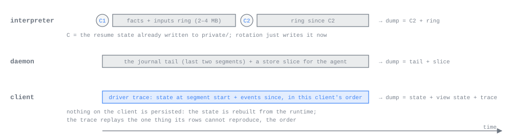

# Debugging

*For anyone, person or agent, working out why amux did something wrong: start here.*

amux is built so that a wrong row on a screen can be traced back to the provider bytes that caused it. Each
process keeps a bounded record of what it was fed, each stage between provider and screen is a pure function that
can be replayed from that record, and one command gathers all of it, redacted, into one directory: a dump. This
page says where things are on disk, how to take and read a dump, and how to narrow a problem to one stage.

## Where to look first

1. **Take a dump while the problem is visible.** `amux dump <agent> --reason "what looks wrong"` prints the
   bundle's directory. Everything below is easier from a dump than from a live system, and the bounded records
   it copies roll over as the agent keeps working.
2. **Read the bundle's `manifest.json`.** Its `errors` list says what could not be gathered (an agent process that
   did not answer, an unreachable host), so a missing file is never a mystery.
3. **Find the stage.** Compare what each layer holds for the item that looks wrong (see [Narrowing a problem to
   one stage](#narrowing-a-problem-to-one-stage)): facts, journal, store, client. The first layer where it goes
   wrong owns the bug.
4. **Read the logs** for the moment it happened: the daemon's `daemon.log` (a redacted tail is in the dump), the
   agent's `agent.log`, and the provider's `private/provider.log`.
5. **Turn it into a test** at the boundary you found, before fixing it (see [Testing](TESTING.md)).

## Where things are

Every file amux keeps is in [the one on-disk listing](ARCHITECTURE.md#everything-else-on-disk), with the agent
directory [just before it](ARCHITECTURE.md#the-agent-directory-is-the-contract). For debugging, the installation
root (`<root>`, normally `~/.local/share/amux`) holds `daemon.log`, `supervisor.log` when amux runs under one, and
`reports/`; each agent's directory, `profiles/<profile id>/agents/<agent id>/`, holds `agent.log` and its
`private/provider.log`.

Every log is capped the same way: past its cap its contents move to `<name>.1`, replacing the previous one, and
the file starts again from empty, so a log and its `.1` are all there is. The caps are 8 MiB for `daemon.log`,
`supervisor.log` and the phone's log, and 1 MiB each for `agent.log` and `provider.log`. The move copies and
truncates in place rather than renaming, so a process's standard error and a provider's, which other handles hold,
keep landing in the live file; the daemon and the supervisor also move their own standard error onto their log, so
a panic is in it. On the phone the embedded runtime keeps the same layout inside the app's container; its log is
`runtime.log`.

What the agent directory is and who writes what is described in [the agent process](AGENT_PROCESS.md); the
journal and the store in [Journal and store](JOURNAL_AND_STORE.md).

## What each process keeps



**The agent process** records every event it feeds its interpreter in the facts ring, `private/facts/`, before
stepping: provider output, inputs, agent messages, ticks, the provider's exit, the daemon going away, stop requests.
Each line is one JSON object:

```json
{"event":"tick","at_ms":1790524769870}
{"event":"fact","channel":"stream","text":"{\"type\":\"assistant\", …}"}
{"event":"input","hex":"0a10…"}
{"event":"agent_message","hex":"0a10…"}
```

Provider payloads are text (hex only if a payload is not UTF-8); inputs and agent messages are their encoded protobuf
in hex. The ring
is two segments named by byte offset, like the journal. A segment rotates when it reaches half the ring's size
(`agent.facts_ring_mib` in the installation config, 4 MiB by default), and the oldest is deleted. Rotation writes a
checkpoint beside the new segment: the interpreter's whole state, as JSON, before the segment's first entry. That
checkpoint is not extra machinery: it is exactly what a resume starts from (the newest checkpoint with its
segment's entries fed through the interpreter again), and so it is also what a replay starts from. Each
incarnation starts a new segment from the state it resumed.

For terminal Claude and Codex the provider's own transcript is also a complete record of what it said; the ring
adds what that transcript lacks (hooks, inputs, ticks). For headless Claude the ring is the only record.

**The daemon** keeps each agent's journal and its rows in the store. Each profile's core takes a checkpoint a
minute after any step that changed a row: its state, serialized once the store's WAL is in its main file. Its
driver records every input the core steps in `core-ring/` beside the store, and starts the ring afresh at each
checkpoint, which heads the segment, so the checkpoint and the ring together are the core's state now. The daemon keeps
every agent's journal from the newest checkpoint's cursor on, and at least the last two segments, so a dump always
has the records behind the newest rows and every frame the recorded inputs read.

**A client** keeps, in memory only, a driver trace per open chat and for the fleet: the session state as it stood
when the trace's older segment began, then every message and driver event since (subscribed, stream ended,
reopened with a tail, backoff, page, get, blob) in the order this client saw them. It holds between 200 and 400
events. The order is the one thing the store's rows cannot reproduce, which is why the trace exists. Nothing on a
client is persisted or checkpointed: its state is rebuilt from the runtime's rows.

## Taking a dump

```sh
amux dump                                 # every agent of the profile, own and replica
amux dump worker reviewer --reason "the reviewer's last answer never appeared"
amux --profile Work dump worker
```

Agents are named by name or id. `amux dump` asks the running daemon, which writes the bundle into
`<root>/reports/` and prints its directory. The bundle is assembled under a dotted name beside its final one and
renamed into place when complete, so a directory without a leading dot is whole. `amux dump --send` also sends it
to the profile's account (see [sending reports](#sending-reports)).

A dump holds only what the dumping host holds. For an agent another host runs, that is this host's replica: its
row and store slice, and the sessions of its chats this client had open. What the other host holds (the agent's
facts ring, its journal, that host's core) is in a dump taken there.

Each dump carries what its trigger replays, and its manifest names that scope:

| Scope | Taken by | Carries |
| --- | --- | --- |
| `host` | `amux dump`, Export Diagnostics on the phone | everything this host holds for the named agents, all of them when none are named |
| `core` | a daemon core check that broke, or a step over budget | `core/`, own agents' journals from the checkpoint's cursor, and the daemon log |
| `agent` | an agent core check that broke, or a step over budget | that agent's process part, its journal (at least two segments), row and slice |
| `transcript` | a chat whose transcript failed its check | that chat's session, and its agent's row and slice |
| `report` | a person's report, from the terminal or the phone | every agent's row, a slice for each agent with a chat open, the client's sessions, `core/` with own journals from its cursor, and the daemon log |

Some dumps nobody asks for. When the daemon's core breaks one of its cheap invariants, or a step runs over its
budget, the daemon writes a bundle whose `reason` starts `the daemon core: ` and whose manifest says `automatic`.
A chat whose transcript fails its own check when the stream catches up or resets asks for one too, with the
reason starting `the client's transcript: ` and that chat's session inside, its trace cut at the message the check
failed at. An agent process whose core breaks one of its invariants, or takes a step over its budget, says so on its
stderr (`the agent core: `) and asks its daemon for a dump of it over the control connection; the daemon writes the bundle, reason starting
`an agent's core: ` and naming the agent, with the agent's facts ring and checkpoints for the interpreter stage.
Every check has a stable id, its core's name and its own (`daemon.generation_fell`, `agent.taken_still_pending`,
`transcript.window`; a step over budget is `<core>.over_budget`), which the manifest's `check` names beside the
sentence in `reason`. The relay, the path machine and the supervisor log the same kind of reason (`the relay core: `,
`the supervisor core: `), and the relay and the supervisor write a text file beside it: the reason, the core's state when the driver's window began,
every input stepped since (at least the last 256) and the state now. The supervisor writes
`<data_dir>/reports/supervisor-<unix ms>-<id>.txt`; a relay writes `relay-<unix ms>-<id>.txt` into `reports/` under its
`state_dir` (see [running the relay](CLOUD.md#running-the-relay)), and a daemon's own relay core into the
installation's `reports/`. Neither core is a replay stage and nothing replays these files: they are what a person
turns into a step test of that core by hand. Each process reports one per kind of reason (one per broken invariant,
one for steps over budget) every ten minutes, and the daemon writes one agent-asked bundle per kind in the same
interval, however many agents ask; the next one of that kind says how many were held back since. Every core times its
steps against a budget of its own: the daemon's 100 ms, the relay's 1 ms, and the agent's and the supervisor's 10 ms.

Each check a limit admits is also counted as a `check_failed` usage event, naming the core, the check's id, whether
it was an invariant or a step over budget, and how many the limit held back since: no reason text and nothing from
the bundle (see [what amux sends](ANALYTICS.md)). It is sent whenever usage events are, so a check that breaks in
the field is seen without anybody sending its dump.

## Reading a dump

A dump is, for each stage, a checkpoint and the inputs since. For the interpreter it is the facts ring's
checkpoint and every fact after it; for the daemon core, its checkpoint, every input it stepped since and the store
as of that checkpoint; for the session, the state a client's chat stood in when its trace began and every message
it applied since, in the order it saw them, or, for an agent no client had open, the store slice a Subscribe opening
delivers. Reading a dump is therefore
running it: each stage is restored from its checkpoint and stepped through its inputs again, with the protocol's
properties judged after every step, so the replay names the step that went wrong instead of leaving a reader to
find it ([replaying a dump](#replaying-a-dump)). The files are laid out as:

```text
reports/dump-<unix ms>-<id>/
  manifest.json                 dump id, time, reason, scope, the check's id for a check's dump,
                                profile, host, generation, daemon version, one entry per agent,
                                and errors
  daemon.log                    the last 1 MiB of the daemon's log and its .1, redacted
  supervisor.log                the same of the supervisor's, when amux runs under one
  agents/<agent id>/
    row.pb                      the inventory row (a wire.Agent)
    store.pb                    the store slice: one wire.Step holding the snapshot and the newest
                                1,000 rows, oldest first, with their orders and revisions
    journal/<segment>           the journal from the segment holding the core's checkpoint's cursor
                                on, at least the last two segments (own agents)
    part/facts/<segment>        the agent process's facts ring, redacted line by line
    part/facts/<segment>.checkpoint
    part/spec.<n>               the spec of each incarnation
    part/agent.log              the tail of the agent's and the provider's logs, each across its .1,
    part/provider.log           redacted
    part/dump-errors            anything the agent process could not read
  core/checkpoint               the daemon core's newest checkpoint
  core/inputs                   every input the core stepped since, and how far each ingest read
                                an agent's journal, one JSON line each
  core/store.sqlite             the profile's store as of that checkpoint
  client/sessions/<agent id>/   each chat the asking client had open:
    checkpoint                  its state when its trace began (a wire.ClientSession: the rows its
                                window held, its inputs and every value the session model keeps)
    events                      every event its driver saw since, through the one that broke it when
                                one did (a wire.ClientSessionEvents: each message, and the driver's
                                own acts as it describes them)
  client/fleet/state.txt        the fleet's part, when the client adds one: the structure of its
  client/fleet/trace.txt        state and its driver trace, with no names, paths or message text
```

Each agent's manifest entry names its kind, whether it is this host's own, its lifecycle and incarnation, how many
rows the slice holds, and the files its process sent. The manifest's `core` entry counts the core's inputs and
journal reads; when the core's part could not be had, it is null and `errors` says why. Its `client` entry names
each chat session's two files and how many events it carries. An agent with no running
process has only its specs in `part/`, and its entry in `errors` says its facts ring was not gathered. Protobuf
files are encoded without a length prefix; journal segments keep the journal's own framing, and every frame keeps
its length, so an offset in the store or in `core/inputs` names the same frame in the bundle. A frame still being
written when the dump was taken keeps only its length prefix. The facts lines are plain JSON and the checkpoints
are JSON, so both can be read directly.

The core's part reveals no pairing opened after the dump: it carries the PIN or secret of a pairing open at the
dump and the randomness that pairing draws from, and every window or pairing conversation opens with fresh
randomness the bundle never holds.

A client hands the daemon its open chats inside the dump call, and the daemon writes them, redacted through each
agent's kind, before the bundle is complete; the fleet's part the client writes into the bundle once the daemon has
answered. `amux dump` from a terminal holds no chat open, so its bundle carries only the host's parts.

## Redaction

Everything in a dump is redacted before it is written, and before it leaves the process that produced it. Only an
interpreter can decode its kind's item and snapshot bodies, so the redactor is per kind, in `crates/interpret`:
the agent process applies it to its facts ring, checkpoints and specs when the dump asks, and the daemon applies it
to every row, store slice, journal frame and client session it writes (the one place the daemon uses per-kind
code). Free text
such as the daemon's log goes through the shared rules in `crates/redaction`. The core's part is redacted as the
core's own values, so it still restores and replays: each protocol message in its checkpoint and inputs is walked
as that message (an agent's opaque bodies inside them, which no kind is there to decode, are emptied), every other
text goes through the shared rules, and ids and numbers are kept; its store copy has each row and item redacted by
its agent's kind and is rebuilt, so nothing the redactor replaced stays in a free page.

The redactor keeps structure and removes secrets: values under secret-named keys, environment values, tokens with
known credential prefixes, secret assignments in text, machine paths, email addresses, the local user and host
name. Provider session and thread ids become a placeholder derived from the id, so one session stays recognisable
across a dump. Conversation text is kept: a dump shows what the agent said and was told. Read a bundle before
sharing it.

## Replaying a dump

A dump runs. `dump-replay` replays a bundle through its four stages, in the order a row passes through them, with
the protocol's properties (the sentences the models in `crates/models` check) judged at every step, and prints one
line per stage:

```sh
cargo build -p replay-support --bins
target/debug/dump-replay reports/dump-<unix ms>-<id>
```

```text
interpreter  holds   1 agent, the facts replayed to the journal's last 6 frames
daemon core  holds   38 inputs from the checkpoint, each step judged
session      holds   1 agent with no client attached from the store's opening, 7 events, the window checked after each
views        holds   5 rows drawn for 1 agent
```

| Stage | Replays | Judged |
| --- | --- | --- |
| interpreter | each agent's facts through its interpreter, from the oldest checkpoint kept | the replay renders as the journal's frames it overlaps, redaction placeholders aside: a resume continues where the last incarnation was |
| daemon core | the core restored from `core/checkpoint` over a copy of `core/store.sqlite`, fed every input in `core/inputs` with each journal it reads cut to where the live step found it, and a commit the live step had refused refused again | after each input: the core asks for no dump, its store keeps every invariant it checks, every row it answers is committed, and every journal read finds what the live one found (a checkpoint plus the inputs since reproduces the state) |
| session | each client session restored from its `checkpoint` and fed every message in its `events`; each agent no client had open, its store slice through the session model as a Subscribe opening delivers it, and the verdict says which | at the checkpoint and after each message or event: the window is one block |
| views | that state through the chat view | nothing: views are functions of state |

A stage that fails prints `FAILS`, the step (the input counted from one, for the core; the message counted from one
after the checkpoint, for a client session, with its place in the trace), the property's sentence and what broke it,
and the command exits non-zero. A client session the manifest names whose files are missing or do not read fails
the session stage as `unreadable`, never holds. The first stage that fails is the culprit. When every stage holds,
the fault is in a driver or in presentation, and the daemon's log tail is where to look. A stage the bundle carries
nothing for prints `absent` and why: a transcript's dump has no core part, an agent's no client session.

A dump the core asked for because one of its invariants broke replays to the step that broke it, naming the
invariant. A dump a chat asked for because its transcript failed its check replays that chat from its checkpoint to
the first message that left the window broken, which can come before the CaughtUp the client checked it at. Replay it with the build that wrote it: a build with the bug fixed steps the same inputs through the fix
and holds, unless the state the checkpoint carries was already broken, in which case it fails at the same step.

Both tools open a dump's directory, a report's directory (its dump is under `dump/`), or a report's
`dump.pb.zst` as downloaded from the account service, which they unpack into a temporary directory first.

The same is a library, `replay-support` (`crates/replay-support/src/bundle.rs` and `replay.rs`):

```rust
let bundle = Bundle::open(path)?;
let verdicts = bundle.replay_all()?;            // one StageVerdict per stage, as dump-replay prints them
let failing = bundle.replay_core()?;            // the core's first failing step and its property, or None
for agent in &bundle.agents {
    let steps = agent.replay_facts()?;          // facts through the interpreter, from the oldest checkpoint
    let state = agent.session();               // the store slice through SessionState, as Subscribe delivers it
    let rows = AgentDump::rows(&state);        // that state through the chat view
}
```

`final_texts(steps)` reduces a sequence of steps to each item key's final text, which is how two sequences are
compared when their revisions differ. The simplest way to work on a bundle is a scratch test beside
`crates/replay-support/tests/bundle.rs` and `core_replay.rs`, which replay bundles the same way: a real daemon's
`amux dump` on a testnet net, written at test time by the build under test, and that bundle with a broken core
checkpoint or a client session missing a row planted in it (`crates/replay-support/tests/support.rs`). A bundle
whose interpreter state format has changed since it was written will not decode its checkpoint; take a fresh one.

### Narrowing a problem to one stage

Find the item that looks wrong by its key, then compare layer by layer:

| Compare | If they differ | The bug is in |
| --- | --- | --- |
| The facts: what the provider actually sent | The provider changed or misbehaved | the provider; check [Interpreters](INTERPRETERS.md) for recordings |
| `replay_facts()` against the journal | The interpreter is not deterministic, or its checkpoint does not resume | the interpreter's state or checkpoint |
| The journal against what the facts should mean | The interpreter decided wrong | the interpreter: add the facts as a fixture in `crates/interpret/fixtures` |
| `store.pb` against the journal | Ingest committed something other than the steps | the daemon's ingest or store |
| `rows(session())` against `store.pb` | The client state or views drew the right rows wrong | `ui-state` or `ui-view`: reproduce from the slice |
| A client session's `events` (`dump-show` prints them) | The order the client saw explains what it drew | the session driver or runtime |
| The screen against the rows | The renderer drew the right rows wrong | the terminal or the phone |

A row carries its agent and key; the key finds the journal frames that wrote it, and the replayed facts show which
event produced the step that first emitted it.

## A report from the terminal

`b` on home, or the leader then `b` in a chat, freezes the screen as it was and opens a report over it; at the same
instant the client starts a dump of the profile with its own parts. Drag with the mouse over anything wrong to mark
it, and each mark takes a note of its own; one note covers the whole. Enter hands the report to the daemon, which
writes it into the installation's `reports/` directory and sends it to the profile's account; the terminal says it
was sent and where the copy is, or where it was kept and why it was not sent. Esc leaves without writing anything.

The bundle, `reports/report-<unix ms>-<id>/`, readable by its user only:

| File | Contents |
| --- | --- |
| `report.json` | The header (schema 3): build, time, note, marks in cells, the viewport in cells, and every part declared present or absent with a reason |
| `frame.txt` | The frozen screen as text, without the report's own panel |
| `frame.json` | The same cells with their colours and styles: each row as runs of one style from their first column, a colour as `#rrggbb`, `ansi:N` or `default` (the terminal's own ink or ground, whose values `default` records) |
| `dump/…` | The profile's dump, as above, with this client's fleet and open chat parts under `client/` |

The client draws no picture itself, so as to carry no fonts: `just shot -- frame <bundle>` draws `frame.json` into
`frame.png` beside it, numbered colours in their conventional values. The client keeps no log of its own (the daemon's is in the
dump) and records no view trace (its runtime's order of events is in the dump's `client/` parts), and
`report.json` says so.

## A report from the phone

A phone gives up its diagnostics two ways, both under Help. **Export Diagnostics** writes a dump of the profile,
with the app runtime's client parts, and hands its directory to the share sheet, so it can be AirDropped or saved
to Files and read as above. **Report a Problem** sends a report to the person's amux account.

Reporting a problem is in every build of the app. Taking a screenshot makes the app freeze its own composited
frame and offer to report it; Report a Problem under Help freezes the screen and opens the report directly. In the
same instant the app starts a dump of the profile. The person marks rectangles on the frozen frame, writes a note
on each and one overall, and presses Send, which hands the report to the app's runtime to write beside its dump and
send to their amux account (the account signed in on screen; with none, Send is refused and says why). A failed send
keeps everything for a retry, which sends the same report again. A person's report is never sent in the background;
a check's dump is, only when **Send Automatic Reports** under **You**, in **This phone**, is on.

The bundle, in the runtime's `reports/report-<unix ms>-<id>/`, holds:

| File | Contents |
| --- | --- |
| `report.json` | Build and git revision, time, note, marks in points with the frame's size and scale, and every part declared present or absent with a reason |
| `frame.png` | The frozen screen, without the status bar |
| `dump/…` | The profile's `report` dump, as above, with the app runtime's client parts |

## Sending reports

A report leaves a machine one way: the runtime (the daemon, or the app's embedded runtime) uploads it to the account
service of the account its profile is signed in to, as `POST /api/reports`, multipart, with the profile's bearer.
The sections are `report.json` (schema 3), the client's frame files (`frame.png`, or `frame.txt` and `frame.json`),
`trace.jsonl` where there is one, and `dump.pb.zst`: the bundle packed as one `wire.DumpPart` and compressed with
zstd, which the replay tools open as it is. A failure the service might not repeat (a server error, a timeout, no
answer) is tried twice more, five and then ten seconds later; after that, or after a refusal, the bundle stays in
`reports/` and the client says why. A signed-out profile sends nothing.

Three things send:

- **A person's report** from the terminal (Enter) or the phone (Send), through `ProfileAdminService.SubmitReport`:
  the client names the dump it took and hands its `report.json` and frame files; the runtime writes them with the
  dump into a report directory and uploads it. Naming that report directory again sends it again.
- **`amux dump --send`**, a `host` dump sent with a header of its own.
- **A check's dump**, sent right after it is written when the installation's `auto_reports` setting is on
  (`amux config set auto_reports true`, read at each dump; on the phone, **Send Automatic Reports**). It is off by
  default because a dump keeps conversation text. Its `report.json` says `kind: automatic`, names the core and
  the check's id, and carries the redacted reason and no frame.

What the account service does with reports is on [Cloud](CLOUD.md); the report screen itself is on [the iPhone
app](IOS.md).
