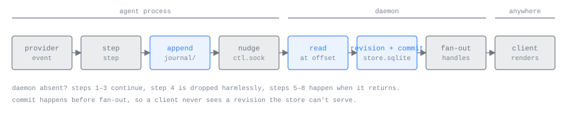

# Journal and store

*For developers working on the journal, ingest or the store.*

Everything an agent does reaches a client along one path. The interpreter in
the agent process turns each provider event into a step and appends it to the
agent's journal. The daemon reads the journal, commits what it finds to the
profile's store and then broadcasts each committed record to the subscriptions
open on that agent. Clients read only through their local runtime, which
serves every call from the store (see [the wire](WIRE.md)).

This page covers the three crates on that path:

| Crate | What it holds |
| --- | --- |
| [`journal`](../crates/journal/src/lib.rs) | Segment files, frames, the `Writer` the agent appends with and the `Reader` ingest reads with |
| [`store`](../crates/store/src/lib.rs) | The schema, the `Sqlite` store the runtime calls, commit for own rows, absorb for replica rows, retention |
| [`daemon-core`](../crates/daemon-core/src/ingest.rs) | Ingest and fan-out, as steps of the daemon's core |
| [`node`](../crates/node/src/runtime.rs) | The watcher that nudges ingest (`ProfileRuntime::ingest`), the generation file, the retention sweeps, peer sources |

How the agent process produces steps is in [the agent process](AGENT_PROCESS.md)
and [interpreters](INTERPRETERS.md). How the daemon is laid out as a whole is in
[the architecture](ARCHITECTURE.md).

## On disk

A profile's store is `profiles/<profile-id>/store.sqlite` under the
installation root, in WAL mode, and each own agent's journal, raw terminal
bytes and blobs are under `profiles/<profile-id>/agents/<agent-id>/`; bytes
fetched for a paired host's agent are under
`profiles/<profile-id>/replicas/<host-id>/agents/<agent-id>/blobs/`. The
generation file is `<root>/generation`. Everything else is in
[the one on-disk listing](ARCHITECTURE.md#everything-else-on-disk).

The names are constants: `GENERATION`, `STORE`, `AGENTS` and `REPLICAS` in
[`crates/node/src/install.rs`](../crates/node/src/install.rs), and `JOURNAL`,
`PTY`, `BLOBS` and `PRIVATE` in
[`crates/agent-dir/src/lib.rs`](../crates/agent-dir/src/lib.rs).

## The journal

The journal is a queue between two processes that needs no acknowledgements
and no shared memory, survives either side dying and can be read from any
offset later. It is a directory of append-only files.

### Segments

Each segment file is named by the global byte offset of its first byte, zero
padded to ten digits (`segment_name`). A reader's whole state is one integer,
a global offset: it opens the segment whose name is the largest at or below
that offset and seeks to the difference.

The writer closes a segment before it creates the next one. A segment is
therefore final, never written again, exactly when a later segment exists.
Nothing else needs to record which files are complete.

The writer rotates when a frame would take a non-empty segment past the
segment size; frames never span segments. The size comes from the agent's spec
(`EffectiveConfig.journal_segment_bytes`) and defaults to 1 MiB
(`DEFAULT_SEGMENT_BYTES` in [`crates/agent/src/host.rs`](../crates/agent/src/host.rs)).
The `pty/` log and the facts ring under `private/facts/` use the same naming
and the same `journal::segments` listing.

### Frames

A frame is a varint length prefix followed by one protobuf `Step`
(`journal::encode_frame`). A `Step` is everything one interpreter step
produced:

| `Step` field | Meaning |
| --- | --- |
| `items` | Full items, keyed by the interpreter. The durable payload. |
| `appends` | Text appended to an item already held |
| `snapshot` | The agent's snapshot, when this step changed it |
| `turn_end` | Set when the step ended a turn: the turn id, the key of the turn's last message, and how the turn ended (a `TurnOutcome`) |
| `incarnation_end` | Set on the last step of an incarnation: why it ended (an `ExitCause`) and the cause's own words. The daemon copies it onto the row when it commits the step |

The snapshot rides in the same frame because it costs nothing, but nothing
depends on it being there: after a restart the interpreter re-derives and
re-emits it. The fields are in
[`records.proto`](../proto/amux/v1/records.proto); their meaning on
the wire is in [the wire](WIRE.md).

`journal::decode_frame` answers one of three things about the front of a
buffer: a whole frame, an incomplete one (more bytes may complete it), or
corruption (a zero length, a length above `MAX_FRAME_BYTES` = 64 MiB, or bytes
that are not a `Step`). A zero length is how the zero-filled tail a file system
can leave after power loss is recognised.

A reader never returns a partial frame. `Reader::read_up_to` reports bytes at
the end of a segment that do not make a whole frame as `Torn`:

- In the newest segment the writer may still be completing the frame, so the
  reader's cursor stays at the last whole frame and a later read picks it up.
- In a final segment the bytes can never complete. The reader skips them,
  reports `Torn { skipped: true }` and continues at the next segment.

`Writer::open` cuts a torn tail off the newest segment, so a restarted agent
appends after its last whole frame. A failed append truncates back to the last
whole frame for the same reason.

### Writing

The agent writes with plain `write` calls and never calls `fsync`. A process
crash loses nothing, because the kernel's page cache survives it. Only an
operating system going down loses unsynced journal bytes, which is what the
generation file below exists for.

The agent appends a step, then sends `Nudge` over `ctl.sock`. If no daemon is
connected the nudge is dropped and the journal simply grows. Within one step
the agent writes blobs first, then the journal, then carries out effects: an
input's verdict is sent and the provider is written to only once the step that
explains it is in the journal (`Host::apply` in
[`crates/agent/src/host.rs`](../crates/agent/src/host.rs)).

A failed journal write, which in practice is a full disk, ends the
incarnation: nothing the provider does from then on could be recorded. The
agent stops the provider, writes its final boundary item if the disk takes it,
and exits with the write failure as its cause (`Host::write_failed`).

## Ingest

Ingest is a step of the profile's core, in
[`crates/daemon-core/src/ingest.rs`](../crates/daemon-core/src/ingest.rs).
Each live agent has one watcher task in
[`crates/node/src/runtime.rs`](../crates/node/src/runtime.rs). It dials
`ctl.sock`, keeps the agent's `AgentHello`, tells the core it arrived, and calls
`ProfileRuntime::ingest` on every `Nudge`, which feeds the core a `Nudge`
input and waits until the journal has been read to its end. It also ingests
when it first adopts a connection, when the startup sweep finds an agent, and
once more when the process is gone, so a journal that ran ahead of the daemon
is always read to its end.

One ingest step:

1. If the core is taking a checkpoint, hold the batch until the checkpoint
   job is done; it is read then.
2. Read the agent's `ingest_cursor` from its row.
3. Read whole frames from that offset with `journal::Reader::read_up_to`, at
   most `INGEST_BATCH` (256) frames.
4. Commit them in one transaction (`Sqlite::commit`), which also writes the
   advanced cursor, and arm the checkpoint timer if it is not armed.
5. Answer each committed record once to every stream open on the agent, and
   the agent's inventory row to every inventory stream if a snapshot was
   committed: it carries the row's phase, `working_on`, since-when and git
   facts.
6. At the end of the journal, the first time after each Hello, set the
   agent's CaughtUp marker and answer `CaughtUp`.
7. If the batch was full, arm a timer for the next one, so every other
   input is stepped between batches.

Answering in the step that commits makes commit order the answer order, and a
stream's opening, answered in a step of its own, reads a cut that is wholly
before or wholly after a batch. What the profile's shell still commits itself
(replica rows, the registry, the host set) it hands to the core before
letting go of the store, and the core steps those changes before anything
that reads the store after them. Batching bounds how long a backlog holds
every other input off: at the measured cost of tens of microseconds a frame,
256 frames take several milliseconds. Each stream's queue holds four batches
of live answers: a batch's records go out in one burst, so a reader's slack
is counted in batches, and a subscriber that has read everything when a batch
lands is closed with `Lagged` only after four whole batches arrive without it
reading any. The queue is sized from the batch; the batch is sized from the
step's length alone.

A torn frame in the newest segment means a write is still under way, so that
pass is not at the end of the journal and does not announce `CaughtUp`; the
next nudge brings the rest.

### Commit and revisions

`Sqlite::commit` ([`crates/store/src/sqlite.rs`](../crates/store/src/sqlite.rs))
processes the frames in journal order, inside one transaction:

| Record | What commit does |
| --- | --- |
| Item | Assigns the agent's next revision. A key the agent already holds keeps its order; a key not held yet takes the next order above the highest committed. Upserts by key. |
| Append | Appends the text to the held item and assigns it the next revision. The broadcast `Append` carries the item's previous revision as `base_revision`. An append naming a key the store does not hold is skipped and counted. |
| Snapshot | Assigns the next revision, stores the snapshot on the agent row and copies `phase`, `working_on`, `phase_since_ms`, `git` and `background_jobs` from its envelope onto the row. |
| Snapshot turning the phase to `PHASE_NEEDS_YOU` | Inserts a `notifications` row due after the push delay. Leaving `PHASE_NEEDS_YOU` deletes the agent's pending rows. |
| `turn_end` on an agent with a parent | Inserts a `deliveries` row carrying a copy of the turn's last message, the turn's outcome and whether it is the incarnation's `last`; a turn end marked last clears `owes_report`. |
| `incarnation_end` | Copies the cause and its words onto the row as `exit_cause` and `exit_detail`. The row stays live until the daemon marks the agent exited, which keeps this cause, so a daemon that stops in between leaves it for the next one. |

Then the row's `ingest_cursor` is set to the offset just past the last frame
and the row is written, in the same transaction as the records it describes.

Three consequences follow:

- Revisions are per agent and strictly increasing, assigned only by the daemon
  that owns the agent. The agent writes zero for `order` and `revision` and
  never learns the values.
- Journal order is item order. An item keeps the order its key was first
  committed at, forever, so a revised item stays where readers saw it.
- Nothing is deleted by commit. An older revision never overwrites a newer one
  in the store or in a client.

The unique index `items_by_position` holds one key per order (the store keeps
the wire `order` in its `position` column), so a bug that would place two keys
at one order fails the transaction instead of corrupting the transcript.

### At-least-once emission

The agent can re-emit records the journal already holds: after a crash it
resumes from its checkpoint and re-derives from the provider's own record. This
is accepted rather than deduplicated. Items are keyed by the provider's own
identifiers, so a re-derived item has the same key and content. Commit gives it
a fresh revision and keeps its order, and clients merge by key with no visible
change.

Appends cannot double, because re-derivation after a restart always emits full
items: every stream ends with a full item, at every restart boundary too.

The `deliveries` primary key includes the child's incarnation, kind and turn
id, and the insert is an upsert, so a turn end committed twice is one row.
Agent messages are deduplicated by the recipient's daemon against the
recipient's items by envelope id, using the `items_by_input` index, once
the acceptance item has committed; a message handed over again before that
is answered by the recipient's interpreter, which takes each envelope id
once per incarnation.

### Checkpoints and reclaiming segments

The profile's core checkpoints an interval (`Launch.checkpoint_interval_ms`,
a minute) after any commit to the store, and when its input ring fills
first. A checkpoint is one job. The step that takes it reads the cursor of
every agent committed since the last checkpoint and asks for a WAL job: a
passive WAL checkpoint on a connection to the store of the job's own
(`Sqlite::checkpoint_wal`), which SQLite syncs, run off the core's thread
because moving the WAL can take tens of milliseconds. Until that job ends,
every input that may write (ingest, the registry, deliveries, trust,
drafts, blobs, replica absorbs) waits in the core in the order it came;
reads, subscriptions, presence, routing and peers' reads step on. The step
that hears the WAL job is done serializes the core, with what waits still
waiting, and hands the state to the driver, which starts a ring segment at
it and feeds one input back; that step lets what waited through, so the
new segment records it, and marks the checkpoint's cursors durable. A WAL
job that cannot move the whole WAL (a reader held it) lets go of what
waited at once, and the next checkpoint is tried an interval on.

Every write to the store is the core's, and SQLite's own automatic
checkpoints are off (`wal_autocheckpoint=0`): the WAL job and the clean
shutdown's flush are the only times the WAL reaches the main file. So the
main file holds exactly what was committed before the hold, whatever the
core commits after it stays in the WAL, and the main file and the state are
the daemon as of one step. The driver records every input the core steps in
`core-ring/` before stepping it, and starts a new ring segment at each
checkpoint: the newest checkpoint and the inputs since rebuild the core.

A segment is deleted only when it lies entirely below an agent's cursor as of
the last checkpoint that reached the drive, so the journal is never the only
copy of something the store might lose. When a checkpoint job is done the core
asks `journal::reclaimable` for the segments wholly below each cursor it
holds, keeps the newest `KEPT_SEGMENTS` (2) of them for dumps, and deletes the
rest; a failed checkpoint deletes nothing and the next is tried an interval
on. Journal therefore waits up to a checkpoint interval to be reclaimed.

## Durability

| Rule | Where |
| --- | --- |
| The agent writes its journal with plain writes and no fsync. | `journal::Writer` |
| The store runs WAL with `synchronous=NORMAL`: no fsync per commit; SQLite syncs at its checkpoints. | `Sqlite::open` in [`crates/store/src/sqlite.rs`](../crates/store/src/sqlite.rs) |
| A journal segment is deleted only below the cursor of the last checkpoint on the drive. | `Daemon::checkpoint_done` in [`crates/daemon-core/src/checkpoints.rs`](../crates/daemon-core/src/checkpoints.rs) |
| `<data_dir>/generation` holds the boot id seen at the last start, a clean-shutdown flag and a counter. | [`crates/node/src/generation.rs`](../crates/node/src/generation.rs) |
| At start, before anything is served: if the boot id differs and the flag is clear, bump the counter; then rewrite the file with the current boot id and the flag cleared. | `daemon_core::generation::at_start` decides; `Generation::start`, called from `node::start`, writes |
| At clean shutdown, last: stop links, background work and watchers, flush every store with `fullfsync`, then set the flag. | `Daemon::shutdown` in [`crates/node/src/daemon.rs`](../crates/node/src/daemon.rs) |
| Both generation writes, and the core's checkpoint, are temp file, fsync, rename, fsync of the directory: the fsync and checkpoint jobs. | `driver::fsync` in [`crates/node/src/driver/mod.rs`](../crates/node/src/driver/mod.rs) |

Why the file exists: revisions are published to other machines, and the store
commits without syncing. A power cut can roll the store back to before
revisions a peer has already seen, and the host would then mint the same
numbers again for different content. Only an unclean reboot loses the page
cache. A daemon crash, an agent crash, an update and a clean reboot lose
nothing committed, so none of them change the counter.

The counter is the host's generation. It travels on the host's inventory entry
(`HostEntry.generation`) and opens every session stream the host serves
(`Opening.generation`). A peer source stores it on the block its Reset begins
(`source_generation`) and names it when it resumes after its cursor; the
origin answers a cursor of another generation with a Reset and a fresh tail,
which forgets every row held under the old one, so each replica is reset on
its own stream. The inventory's `CaughtUp` records the new
generation (`Sqlite::record_host_generation`) for the host entry this machine
publishes. That invalidation restores consistency between machines; it cannot
recover work whose only copies were lost.

After power loss on the origin:

- The store opens at its last durable transaction, with the cursor and
  `next_revision` that go with it.
- Ingest finds the cursor either still inside the journal, and re-reads the
  same frames from there, producing the same revisions with the same content;
  or beyond the journal's end (`journal::end`), because the unsynced journal
  lost its tail. In that case `Sqlite::rewind_cursor` moves the cursor back to
  the last whole frame and keeps `next_revision`, so whatever the agent writes
  again takes revisions every reader has not seen.
- Raw terminal bytes from those seconds are gone.

The Windows boot id is the boot time rounded to ten seconds. A reading that
lands across a rounding edge looks like a reboot, which bumps the counter only
after an unclean shutdown, the safe direction.

## The store

One SQLite file per profile, `profiles/<profile-id>/store.sqlite`. It is the
truth for this host's own agents, a cache of paired hosts' agents, and the only
history any client on the machine reads.

### Writer and readers

The profile runtime is the store's only writer and only reader: the daemon on
a desktop, and the embedded runtime in the phone app. No client opens the file,
not even the terminal client on the same machine. Every client reads through
`SubscribeSession`, `ListItems` and `GetItem` against its local runtime; on the phone that is
an in-process call. The profile's core thread owns the open store: every
write is made in the core step that decides it, and every read the runtime
serves runs on that thread in one read transaction, so each read sees one
commit point and no lock is needed. The one other connection is the passive
WAL checkpoint, which the driver runs as a job off the core thread (see
Durability). A write is an ordinary commit, left to the WAL and the next
checkpoint, unless it is `Durability::Synced`: that transaction runs with
`synchronous=FULL` and `fullfsync`, and only pairing, unpairing, a key
replacement and a pairing's rollback ask for it.

The runtime's interface is `store::Sqlite`, in
[`crates/store/src/sqlite.rs`](../crates/store/src/sqlite.rs):

| Method | Use |
| --- | --- |
| `agent`, `agents` | Agent rows, own and replica |
| `agent_by_id`, `agents_of_parent`, `agent_by_name` | The row an agent id names (this host's own first), a parent's children on any host, and every row with a name |
| `cut(agent, n)` | The snapshot, the newest `n` rows of the block and the marker, read together: what a subscription opens with |
| `page(agent, before_order, limit)` | Older rows by order, newest first, from the block only; says whether it ended at the limit, at the block's boundary, or at the end of history |
| `get(agent, key)` | One held item, in the block or not |
| `after(agent, revision, cap)` | What a peer holding everything through `revision` is missing, or `None` when that is more than `cap` rows |
| `commit` | Journal frames into an own row |
| `absorb` | Records from a peer into a replica row |
| `item_by_input`, `last_n`, `cursor`, `live_descendants` | The item carrying an input (for an agent message, proof its recipient took it), the newest rows of the block, a row's cursor (ingest for an own row, source for a replica), and the live agents below a parent across hosts |
| `put_agent`, `set_descendants`, `delete_agent`, `set_marker` | A row whole, or the columns its role owns; an own row's count of live descendants; an agent removed whole, with its items, deliveries and notifications; the in-memory CaughtUp and Detached markers |
| `rewind_cursor`, `record_host_generation`, `host_generation` | Power-loss recovery on this host; the generation a peer last reported |
| `trusted_hosts`, `put_trusted_host`, `remove_trusted_host` | Paired hosts; a removal forgets the host's generation too |
| `draft`, `put_draft`, `delete_draft` | The unsent draft for an agent, as the client encoded it |
| `record_recent_directory`, `recent_directories` | The folders agents were started in, newest first, the 200 most recent kept |
| `put_delivery`, `deliveries`, `remove_delivery` | Completion reports a child owes its parent on another host |
| `notifications`, `remove_notifications`, `remove_notification` | Pushes owed for an agent's attention |
| `pool_bytes`, `sweep_own`, `sweep_replicas` | Retention |
| `flush_to_drive`, `checkpoint_wal` | Clean shutdown's synced checkpoint; the passive checkpoint on a connection of its own |

Each call is one transaction, and SQL does the work: an item is one upsert
that keeps a held key's order, a replica's item is written only over an older
revision, and a pool's bytes are one sum. Every write to `agents` and `items`
but one is an `INSERT ... ON CONFLICT DO UPDATE` that names the columns its
writer owns, and a commit's writes must stay so, because the daemon's
crash-injection tests fail a commit with a `BEFORE INSERT` trigger, which a
bare `UPDATE` would slip past. The exception is `rewind_cursor`, a bare
`UPDATE` run in power-loss recovery outside any commit. Each upsert's columns
are its writer's: an own row's registry columns come from the daemon, a
replica's from its origin's inventory row, and the snapshot envelope and
cursors from commit or absorb. The conformance suite in
[`crates/store/tests/conformance.rs`](../crates/store/tests/conformance.rs)
holds the store to its answers against a temporary database file.

The CaughtUp and Detached markers are not persisted. They live in memory beside
the connection and are rebuilt as ingest and sources run.

### Schema

The schema is the text in
[`crates/store/src/schema.rs`](../crates/store/src/schema.rs).

`agents`: one row per agent, own or replica, keyed by `(origin_host, agent_id)`.

| Column | Meaning |
| --- | --- |
| `origin_host`, `agent_id` | This host for own rows; the owning host for replicas |
| `kind` | The agent's `Kind`, as its wire integer |
| `name`, `cwd` | As the registry holds them; every agent has a name, given or chosen by the daemon |
| `parent_host`, `parent_id` | A child records its parent as host and id, because families cross hosts |
| `lifecycle`, `exit_cause`, `exit_detail` | Live or exited, and why: the `ExitCause` as its wire integer, so a cause from a newer host is kept and served as it came, and the cause's own words. Owned by the daemon: commit copies the agent's own cause from its journal's `incarnation_end`, and marking the agent exited records the daemon's own cause only where the row has none. A resume clears both. |
| `phase`, `working_on`, `phase_since_ms`, `git`, `background_jobs` | Copied from the newest snapshot's envelope at commit, and on a replica row when absorb takes a snapshot from the origin. The snapshot's own `at_ms`, never commit time, orders own rows' retention. A replica row also takes `phase`, `working_on`, `phase_since_ms`, `git` and `background_jobs` from the origin's inventory row, which carries no last activity, so replica retention orders by `phase_since_ms`, which every replica row has |
| `descendants` | Live agents below this one. An own row's is counted by its daemon whenever a row below it is written or removed, walking into its own agents and taking each replica's count for what lies below it; a replica row takes its origin's count from the inventory row. A registry write leaves it alone |
| `snapshot` | The newest snapshot, body opaque; it carries its own revision |
| `ingest_cursor` | Own rows: the journal offset committed through |
| `next_revision` | Own rows: the revision the next record takes |
| `source_cursor` | Replica rows: the origin revision this agent's source is complete through |
| `source_generation` | Replica rows: the origin generation the block was taken under, from the `Opening` of the stream whose `Reset` began it |
| `complete_from_order` | The order from which the held rows are known to be contiguous up to the newest (see below) |
| `exhausted` | No older history exists: the origin said so, or retention trimmed it |
| `owes_report` | Own rows: the incarnation has not yet sent its parent its last report, from its start until a turn end marked `last` (and again should a later turn start). An incarnation that exits still owing one, its turn open or ended idle, tells its parent it failed. |
| `created_at_ms`, `incarnation` | Creation time and the `spec.<n>` it is running |

Kind, lifecycle, exit cause and phase are stored as their wire integers, so a value from
a newer peer is stored and served rather than refused.

`items`: one row per item, keyed by `(origin_host, agent_id, key)`.

| Column | Meaning |
| --- | --- |
| `key` | The interpreter's key |
| `position` | The wire `order`: transcript position, assigned once per key |
| `revision` | Assigned on every upsert |
| `at_ms` | When it happened, from the envelope |
| `input_id` | Set on a prompt's reflection and on an agent message's item |
| `text` | The one appendable field |
| `kind` | The envelope's `Kind`, as its wire integer: which per-kind body this is |
| `attachments` | The envelope's attachment list, encoded |
| `body` | The per-kind body, never decoded or re-encoded by the store |

Three indexes sit on `items`: `items_by_position` (unique: one key per order),
`items_by_revision` (what `after` reads) and `items_by_input` (partial, where
`input_id` is set: the agent-message dedupe).

The rest:

| Table | Rows |
| --- | --- |
| `deliveries` | The daemon's outbox to parents: a child's report that a turn ended (`text` is its last message, `outcome` how the turn ended, `last` whether it was the incarnation's last) or, with `exited` set, that the incarnation ended without a last report (`exit_cause` and `exit_detail` say how, as the row's do; always the incarnation's last), so each child incarnation sends exactly one last report. Keyed by child, incarnation, `exited` and turn id; the parent is the one the child's row names. Holds a copy of the message, because retention may remove the child's transcript while a parent is offline. |
| `notifications` | The push outbox: one row per turn into `needs_you`, keyed by agent and snapshot revision, with a due time (`due_at_ms`) and the push's `name`, `working_on` and `text`, built from envelope fields only. Deleted unsent if the phase leaves `needs_you` first, and with the agent. |
| `hosts` | One row per peer host: the generation its inventory last reported, for the host entry this machine publishes. |
| `trusted_hosts` | One row per paired host: its pinned key, name, when it was paired, whether it is on the account, what it last said of itself (signed in, platform), its SSH target, the addresses it last answered at and the addresses it listed with their sources (both JSON). Pairing, unpairing, a key replacement and a rollback commit synced; the rest are ordinary commits. |
| `drafts` | This machine's clients' unsent draft per agent, an encoded `amux.v1.Draft`. Deleted when it is emptied and when the agent goes. |
| `recent_directories` | The directories agents were started in, with when each was last used: the 200 newest are kept, and a directory stays after the agents that ran there are deleted. |

The schema's own text comments every column.

There are no blob tables. A blob is a file in its agent's directory; its name,
mime type and size are on the attachment in the item that references it, and it
lives as long as that directory. See [attachments](ATTACHMENTS.md).

The outbox drains are in [`crates/node/src/outbox.rs`](../crates/node/src/outbox.rs).
The shipped daemon and the phone runtime install `NoopSender` as the push
sender, so notification rows are written, fall due and are deleted without a
push being sent.

### Schema version

The schema is one text and there are no migrations. Every table is `STRICT`, so a value of the wrong
type is refused rather than stored. Opening a fresh file takes the write lock
and creates the whole schema in one transaction, stamping the file's
`application_id` (an amux store) and `user_version` (`SCHEMA_VERSION`). Any
other SQLite file is refused as foreign, and a store stamped with another
version, as every store written before a schema change is, fails with
`OpenError::OtherSchema`: the error names the file, the daemon does not start,
and the file is left exactly as it was, for the person to move aside. A schema
change raises `SCHEMA_VERSION`.

### Own rows and replica rows

One table and one `origin_host` column hold both, with two write paths and two
retention policies.

Own rows are the truth. Only `commit` writes their records; they are removed
only by delete and by retention.

Replica rows are a cache of a paired host's agent. Only `absorb` writes their
records, copying the origin's revisions and orders as received. Each replica
agent has one source in [`crates/daemon-core/src/sources.rs`](../crates/daemon-core/src/sources.rs):
one `SubscribeSession` to the origin. With no block it asks for a tail of K rows; with
one it asks for what came after its `source_cursor`, capped at K, under its
`source_generation`, and the origin answers either that delta or `Reset` and a
fresh tail. The source holds
a catch-up until the origin's `CaughtUp` and then absorbs it in one go, so a
stream that dies midway never leaves the block half-replaced.

**The block.** A replica's rows for an agent are either empty or one
contiguous block ending at the origin's newest row, and only the agent's source
writes the top of it. `complete_from_order` records where the block starts.
That is what lets many subscriptions and any number of pages share one cache
with no reconciliation: a page inside the block is served from it; a page below
it is fetched from the origin and extends the block.

**Absorb.** Every write into a replica goes through `Sqlite::absorb`:

| `Absorb` | Effect |
| --- | --- |
| `Delta { events, live }` | Joins the block above its newest row. Items are upserted unless a newer revision is held; an append applies only when its base matches; a snapshot only when newer. Live records advance `source_cursor`; a catch-up does not. |
| `Reset { tail, snapshot, generation }` | Starts the block again from the tail under the origin's `generation`: `complete_from_order` moves to the tail's oldest order. Rows below stay stored and are served by `GetItem`, but do not count as contiguous. Under a generation other than the block's, every held row is forgotten first: the origin numbers orders and revisions afresh after an unclean reboot, so nothing held compares with the tail. |
| `Page { before_order, items, exhausted }` | Extends the block downward, only when `before_order` is the block's boundary. A page that does not join is served to its requester and not stored, because only a source starts a block. |
| `CaughtUp(revision)` | Sets `source_cursor` to the revision the origin's replay is complete through |

Absorb is idempotent by key, and an older revision never overwrites a newer
one, so pages and a live source need no coordination. The row's snapshot and
`source_cursor` are written in the same transaction as the items they describe.

A replica row is dropped when its origin's inventory, read to `CaughtUp`, does
not list the agent, and when its host is untrusted. A change of the origin's
generation resets the block instead, on the agent's own stream.

### Retention

Retention runs when the runtime's background work starts and then every ten
minutes (`ProfileRuntime::start_retention` in
[`crates/node/src/retention.rs`](../crates/node/src/retention.rs)). The store
decides what goes; the daemon then closes the removed agents' streams, tells the
fleet (`AgentRemoved` with reason `REMOVAL_REASON_RETENTION`) and deletes their
directories, which takes their blobs with them. A row costs the bytes of the
envelope's variable fields, 4 bytes for its kind and a fixed 48 bytes a row,
counted in the store's SQL.

**Own rows** (`Sqlite::sweep_own`, in
[`crates/store/src/retention.rs`](../crates/store/src/retention.rs)), against
the profile's own budget:

1. Remove exited agents whole, least recent activity first. An exited child
   whose parent's row says live is skipped, because its parent can still send
   to it; a parent goes together with its descendants, and one with a live
   descendant stays.
2. If still over, trim live agents in rounds: each round takes the largest live
   agent and deletes its oldest rows until about one chunk of bytes is gone,
   then measures again. No agent is taken below its newest K rows.
3. When every live agent is at K and the pool is still over, the sweep stops;
   from there the budget is soft.

A trim sets the agent's `complete_from_order` and `exhausted`, so `ListItems`
truthfully reports no older history. Trimmed own history is gone for good,
since the journal below the cursor was already deleted.

**Replica rows** (`Sqlite::sweep_replicas`), against the replica budget:

1. Agents with no open source lose all their rows, least recently used first:
   by when this host last read them, or, for one it has not read, by when its
   phase began.
   Their agents row stays, with an empty block, because it is the origin's
   registry entry: it says whether a parent is live and which incarnation a
   child's delivery names.
2. If still over, sourced agents first lose any rows a Reset left below their
   block, then are trimmed to their newest K rows, largest first, keeping the
   block contiguous.

**Replica blob files** have their own byte budget, evicted least recently read
first (`store::BlobLru`), independent of rows: they are disposable and
refetchable. The one exception is the catalogue blob each remaining replica's
snapshot names, which the sweep never evicts, so a chat can still offer its
agent's models and commands while the agent's host is away. Own blobs have no budget of their own; they go with their agent's
directory, and the own budget counts rows, not blob files.

The budgets and K are listed in [parameters](PARAMETERS.md).

### Disk full

- **Agent journal write**: the incarnation ends, as described under
  [Writing](#writing). The next incarnation writes any missing boundary when it
  starts.
- **Blob write**: `PutBlob` fails with `RESOURCE_EXHAUSTED` and leaves nothing
  behind. A blob the agent writes itself fails like a journal write and ends
  the incarnation the same way.
- **Store commit**: the transaction fails and the cursor does not move. Ingest
  logs the error and the next nudge reads the same frames again.

## Tests

The rules on this page are promises of the daemon core, written once as
properties in [`crates/models`](../crates/models/README.md) and checked by
exploring the real core over a real store in memory, under crashes, power
loss and unclean reboots:

| Machine | Its promises about the journal and the store |
| --- | --- |
| single daemon | commit before broadcast; the open is one cut; a segment is reclaimed only below the last checkpoint's cursor; the generation bumps after an unclean reboot, and only then; a checkpoint plus the inputs since reproduces the state |
| replication | a replica's block is contiguous and agrees with the origin; no row survives from another generation; the cursor is complete |

Each is written in full in the models' `src/single_daemon.rs` and
`src/replication.rs`. What the models do not reach, the files themselves (a
torn tail, a frame cut at a byte, a store of another schema, the SQLite file
on another platform), is held by named tests. The main ones:

| Where | What it holds |
| --- | --- |
| [`crates/journal/tests/journal.rs`](../crates/journal/tests/journal.rs) | Segment naming, rotation, torn tails, reclaim below a cursor |
| [`crates/store/tests/conformance.rs`](../crates/store/tests/conformance.rs) | Commit, absorb, pages, cuts, lookups and deletes |
| [`crates/store/tests/sqlite.rs`](../crates/store/tests/sqlite.rs) | Refusing a store of another schema, one transaction per commit, reopening |
| [`crates/store/tests/retention.rs`](../crates/store/tests/retention.rs) | Own and replica sweeps |
| [`crates/node/tests/single_daemon.rs`](../crates/node/tests/single_daemon.rs) | Ingest, re-derivation, power loss and the generation bump |

Power loss is tested without cutting power: the test truncates the WAL to its
last checkpoint and the journal to an arbitrary byte, then restarts the daemon
under a different boot id. See [testing](TESTING.md).
