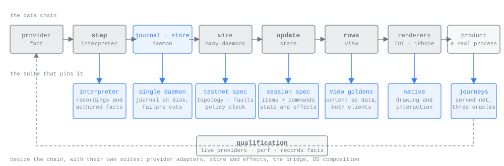

# Testing

*For developers adding a test, running one, or deciding where a new one belongs.*

This page is an index. The suites themselves are listed in `tests/catalog.toml`; `just --list` is the command
surface. The multi-host harness has its own page,
[TestNet](TESTNET.md), measured performance has [Performance](PERFORMANCE.md), the phone's snapshots
and journeys are described in [the iPhone app](IOS.md), and adversarial testing by agents has
[QA](QA.md).

## The rule

Test at the smallest boundary that contains the code whose promise can fail. Most cases use explicit inputs and
a driven policy clock; a smaller set uses real sockets, files and processes; a few complete stories drive each
client through its real UI. Every suite says what is real, what is replaced, and which observation would reject
the failure it exists to catch.



The data chain is how a provider's output becomes something a person sees: a provider fact becomes an
interpreter step, the step becomes journal records and store rows, rows become session state in a client, the
state becomes views, and views become terminal cells or phone pixels. The chain names the suites and says where
fixtures come from. It is not the whole product: provider IO, SQLite, the Swift bridge, process ownership and
native interaction sit beside it and can each fail on their own, so they have suites too. A test goes at the
lowest boundary that can catch its failure: a view test of an ask card does not replace the Swift test that
proves the button sends the answer, and neither needs a relay and a simulator.

## Boundaries

Each catalogued suite names one boundary.

| Boundary | What it proves | Main homes |
| --- | --- | --- |
| Interpreter | Each provider event yields one step: keyed items, appends and a snapshot, with no hidden IO or clock; checkpoints resume from any prefix. | `crates/interpret/tests`, `crates/attachments` |
| Provider adapter | Real provider bytes and hooks reach the interpreter, commands produce the right provider writes, and captures join the corpus sanitized and inventoried. Terminal Claude's cases run on Unix only: Windows does not host it (see [Windows, as a stated cost](ARCHITECTURE.md#windows-as-a-stated-cost)). | `crates/agent/tests`, `crates/claude-specs`, `crates/provider-fakes`, `crates/replay-support` |
| Single daemon | Ingest commits a step's items, snapshot and cursor together, assigns revisions, pages and subscribes without loss, and reclaims only what was ingested. | `crates/journal`, `crates/store`, `crates/node/tests` |
| Many daemons | Discovery, trust, routing, relay, replication, inventory, families and blobs hold across production runtimes under faults. | `crates/testnet/tests` |
| Client model | `update(state, msg)` gives the same state under any arrival order; inputs reach a settled, rejected or uncertain state. | `crates/ui-state/tests/spec` |
| Store, effects, bridge | Runtimes and the embedded owner reach the right service; Swift decodes and applies the Rust view and command contract. | `crates/ui-runtime`, `crates/app-runtime`, `crates/app-embedded`, `crates/client`, Swift unit suites |
| Views | Each view is a pure function of session state; row ids are item keys and never move. | `crates/ui-view/tests` |
| Native presentation | The terminal and the phone draw a view correctly and interaction sends the right command. The phone's compared pictures are drawn with reduce transparency on, so they hold no glass the render server finishes on its own schedule. | `crates/tui/tests`, `apps/apple` snapshot suites |
| System composition | Built binaries launch, survive, stop and clean up as promised: agents outlive a killed daemon, the supervisor updates and rolls back. | `crates/amux/tests`, `crates/agent/tests/lifecycle.rs`, `crates/node/tests/supervisor.rs` |
| Journeys | A person completes a declared task through a real client and the production path. | `journeys/`, `crates/testnet/src/journey`, `crates/amux/tests/system_journeys.rs` |
| Model | A protocol promise, written as a sentence, holds in every state a checker reaches by exploring the real code on small instances. | `crates/models` |

Choose cases by distinct transitions, authorities and failure cuts, not by product words: "allow this ask" rightly
appears in interpreter semantics, in Swift command dispatch and in one journey, because each catches a different
failure. Pair every replay or golden with explicit expected outcomes at the transitions that matter; a replay can
reproduce its own mistake.

## The Model boundary

A promise the protocol makes is a property: a sentence a person would argue over, and a predicate over a core's
state that says whether it holds. The properties live in [`crates/models`](../crates/models/README.md), one
machine per slice of the protocol (the single daemon under crashes and power loss, replication between an origin
and a replica, presence and routing, families and deliveries, an agent's lifecycle, the supervisor's update, the
client model, and the composed net of several daemons and their agents; a lamp and its switch test the checker
itself). A machine holds real state, calls the real cores, store and session model on small instances, and lists
the faults its environment may inject. A checker explores every state the machine reaches within its bounds and judges every
property in each: an always must hold everywhere, a sometimes must be reached, an eventually must hold on every
path that ends. A failure prints a path to the state that broke it.

```sh
just test-crate models                     # every machine at its CI bounds
just suite protocol-models family::        # one machine
just models-nightly [machine..]            # the larger nightly bounds, one machine after another
```

Each machine's CI bounds are sized to finish within its CI job's time guard on a four-core runner, and its
nightly bounds explore more keys, faults and steps. The Model boundary owns rules; the other boundaries own what the cores do not
decide: a driver's sockets and deadlines, a real process, a provider's bytes, what a screen draws. A test that
restates a rule a property holds is a second copy of the rule, so it goes.

Properties over pure functions that are not protocol state (the client model taking items in any arrival order,
its run index, the views' row ids) generate their cases rather than looping over seeds: each case is a value
built from what can happen, and a failure is shrunk to the smallest case that still fails before it is reported.
A fixed seed keeps a run repeatable.

## One rule, one implementation

No protocol rule is written twice. The rules live only in the cores' code; there is no abstract model of the
protocol to keep in step with it and no conformance copy. A property states what must be true and the checker
runs the real code to find out. The phone's Swift chat model writes none of them again: it applies the deltas the
runtime computes, and app-runtime's tests walk the client model's seeded schedules and hold the keys those deltas
leave equal to the session's window at every cut.

## A plant round before deletion

A suite's examples go only when a property is shown to catch what they caught. Before a machine's stories and
example tests are deleted, bugs are planted in the code they guard (a broadcast before its commit, a segment
reclaimed above the checkpoint's cursor, a stale listing deleting a child), each chosen to break a promise those
tests were there for. The machine's checker must fail on every plant at its CI bounds, naming the property and
the path; then the plants are reverted, and one commit deletes the tests the properties cover and names the
plants and the counterexamples that caught them. A plant the checker misses means a property is weak or a model
action hides an interleaving, and nothing is deleted until it is fixed. Tests that reach what no model holds (a
real process, a real carrier, a file cut at a byte) stay.

## Lanes

A lane says when and where a suite runs.

| Lane | What it holds | Where it runs |
| --- | --- | --- |
| fast | Offline, credential-free, deterministic suites: most of the table above. | `just test` on every push, on Linux, macOS and Windows; `just ios gate` for the phone when a push touches it |
| system | Real processes, PTYs, sockets and the supervisor, with bounded deadlines. | Also `just test`, since they are ordinary Cargo targets; the store on the simulator in `just ios captures` |
| journey | Both clients driving complete stories against a served network. | Terminal journeys on every push (Linux and macOS); phone journeys and the accessibility audit in `just ios captures`, by hand |
| tool | The repository's own machinery: scripts, source policy, CI command surface, the shipping-scope audit. | Beside the fast lane |
| qualification | Live providers, measured performance, production cloud and purchases. | Only on request, on enrolled machines; results are `pass`, `fail`, `unavailable` or `not_run` |

Nothing in an ordinary push inherits credentials, spending or hardware. The live lane is the `live` feature of the
qualification crate; `just test` and `just ci` never select it. `just ci` refuses to start when an `UPDATE_*`
variable is set, so no asserted run can rewrite a golden.

## Two modes of the many-daemons harness

A [TestNet](TESTNET.md) story is written once against the harness's verbs and runs on either net:

| Mode | What runs | What decides the order | A failure is |
| --- | --- | --- | --- |
| real | Production daemon runtimes in one process, real agent processes on the fake providers, real links over loopback | The operating system's scheduler and real time, bounded by deadlines | the story's assertion and the net's trace |
| simulated | Every host's daemon core over an in-memory store and every agent's core over the test kind's interpreter, with links, jobs, clock and processes in memory | A seed: each delivery is the one the seed picks among those waiting | the seed that reproduces it, with the trace of deliveries |

The simulated net is the composed-net machine walked by seed, so the checker and the simulator explore one
definition; a story is decided entirely by its seed, runs in milliseconds, and checks the cores' invariants after
every step. Its links come up only on the cores' own dials, as on a real net, and while a story waits with nothing
left to deliver, link time runs on to the cores' next redial, within the wait's patience, as it does in real time on
the real net. What it does not have (the relay, the LAN, process hosts, real providers) it refuses at start. Suites
whose stories run in both modes say so in the catalogue's `modes`.

```sh
just sim                         # every simulated story, a few seeds each
just sim --seeds 300 <name>      # 300 seeds of each story whose test name contains <name>
just sim --seed 17 <name>        # exactly the failing seed, as a failure prints it
just sim --seeds 2000            # thousands of seeds per story, as the nightly workflow walks them
```

Under `cargo nextest run` the same switch is the environment: `TESTNET_MODE=simulated`, with `TESTNET_SEEDS=N` or
`TESTNET_SEED=N`.

## The catalogue

`tests/catalog.toml` lists every suite once: its contract in a sentence, paths, focused recipe, boundary, oracle,
what is real and what is substituted, its time requirement (`none`, `driven` or `real`), required capabilities,
lane, evidence location, update command, and the Cargo targets, features and journeys it owns. A crate's
integration suites are modules of its one integration test binary (`tests/integration.rs` declares one per suite, so
the crate links its tests once rather than once a suite), and a suite names them as `modules`; `just suite <name>`
runs exactly what a suite lists. A suite that must be the only one in its process under every runner, not only
nextest (the sanitizers and the iOS store run use one process per binary), keeps a test target of its own:
app-embedded's `runtime_log`, whose log is the process's one trace subscriber, and the live lane's harnessless
targets.

```sh
just tests-list    # print the catalogue: suite, boundary, lane, time, recipe
just tests-check   # fail on a missing recipe, target, module, feature, journey or baseline,
                   # or on a test target or suite module the catalogue does not list
```

## Running tests

Every Rust test runs under [cargo-nextest](https://nexte.st), each in a process of its own, configured in
[`.config/nextest.toml`](../.config/nextest.toml); the `just` test recipes refuse to start without it (`brew install
cargo-nextest`, or `cargo install --locked cargo-nextest`). A process per test means no test shares a global, an
environment variable or a once-built fixture with another, whatever runs beside it. No test builds a binary: a
setup script ([`scripts/test-binaries.sh`](../scripts/test-binaries.sh)) builds `amux`, the fake providers,
`fake-amux` and the agent's install-path stand-in once before any test starts and names their directory in
`TESTNET_BINARIES`, and a test started without it fails saying so rather than running binaries older than the
source. A test is reported slow after a minute and ended after three; a test that ends while a process it started
still holds its output fails, since that process would outlive it. The documentation tests, the live lane (whose
tests have their own harness), the C ABI's pointer checks (`just miri`) and the sanitizers still run under
`cargo test`.

```sh
just test                                  # every ordinary workspace target
just suite many-daemon-protocol-spec       # one suite of tests/catalog.toml, on `just test`'s build
just suite link-stories relaunch           # the same, then a test-name filter
just test-crate interpret -- codex::       # one crate, then nextest arguments
just suite sqlite-store-contract           # the store's reader and writer suite, retention and SQLite file
just suite client-model-spec               # the client model spec
just test-tui                              # terminal presentation and goldens
just offline-test                          # workspace tests with isolated config and no network (Linux, sudo)
just journey terminal reach-host           # one terminal journey
just journey terminal all                  # every terminal story, one line each, keeps going after a failure
just journey system survive-daemon         # the built binaries' system journey
just ios unit                              # phone package and app-hosted unit suites
just ios journey                           # the shared stories on the phone; `-- <story>` for one
just live claude_sdk all                   # live compatibility for one kind (qualification)
just live codex attach                     # Codex's own app co-driving a fresh agent; capture in target/live/codex-attach
just perf                                  # performance qualification (see Performance)
just coverage                              # every workspace test with line coverage per crate
just flaky <test> 200                      # one test 200 times in a row, stopping at its first failure
just flaky --load <test>                   # the same with every core kept busy beside it
just fuzz-smoke                            # each fuzz target for 30 s; fails on a crash
just sanitize address                      # the unsafe code's tests under the address sanitizer
just sanitize thread                       # the same under the thread sanitizer (Linux only)
```

`just flaky` is how a test that fails now and then is made to fail on demand: it runs every test whose name contains
its argument, one run after another (50 by default), and stops at the first failure with that run's output.
`--load` keeps every core busy meanwhile, as a full parallel run or a slow CI runner does, which is where most
timing failures show; a failure that `--load` cannot bring back but a full run can is contention with other tests
rather than with the CPU. To see what the net's in-process hosts did in a failing test, set `RUST_LOG`
(`RUST_LOG=warn,daemon_core=debug,node=info`): their tracing goes to the test's standard error, which nextest shows
for a test that failed. Hosts the net runs as processes do not inherit it; their daemon logs are theirs.

`just coverage` writes `target/coverage/coverage.md`: line coverage per crate and the commit it measured. Each crate's lines
count whichever tests ran them, so a core's figure includes what the models and the testnet reach. It is a reading
aid for judging which tests earn their keep, not a gate. The recipe's comment names the coverage tool and the
toolchain component it needs.

`just fuzz-smoke` fuzzes the code that reads bytes amux did not write: the tolerant Claude and Codex decoders, the
journal's frame decoder and its reader over segments cut anywhere, and redaction of JSON values and free text. The
targets live in `fuzz/`, a workspace of their own built on the pinned nightly with debug assertions on. Each starts
from seeds cut from the recorded provider captures and a real agent's journal and runs for 30 seconds (`--seconds N`;
target names narrow the run); its corpus and any crashing input stay under `target/fuzz/`, and a crash prints the
command that replays it. The recipe's comment names the tool it needs installed.

`just sanitize address` and `just sanitize thread` run the tests that reach amux's unsafe code and C: the phone's C
ABI and runtime, the store over SQLite, the journal, the pty host, the agent socket, and the library tests of the node
and the terminal client. Each builds on the pinned nightly with the standard library under the sanitizer, in
`target/sanitize/<kind>`, along with the `amux` and fake providers the tests' nets start, so their agents run under it
too. The address sanitizer fails on an access outside an allocation, a use after free or a double free, the thread
sanitizer on a data race. The C itself is not instrumented, so a race inside SQLite goes unseen, but a bad free in
it does not. The app-ffi tests `just miri` leaves out (an installation, a tokio runtime) run here. The thread sanitizer runs
on Linux only; [`scripts/sanitize.py`](../scripts/sanitize.py) says what it got wrong on macOS, and
[`scripts/sanitize-thread.supp`](../scripts/sanitize-thread.supp) lists the reports it makes that are not races.

`just tests-list` gives the focused recipe for every suite. Recipes carry outer timeouts; a timeout that fires is a
hang to diagnose, not a limit to raise. On macOS a freshly built test binary can stall before its first
instruction while the system assesses it; rerun before diagnosing a first-launch timeout.

## Time

Three clocks are kept apart. Policy time (retention, outbox retries and notification delays, credential
refresh, reply and start deadlines) is injected: each timer takes its clock as a parameter, the interpreter has no
clock at all and receives quiet periods as tick events, and the harness advances a `DrivenClock` to just before,
at and after a real boundary.
Transport time (QUIC timers, sockets, processes) runs normally, and so does the daemon core's link time, which its
dial deadlines and pauses and how long a link lived are reckoned in. Harness deadlines are real and bounded, still
fire when policy time is stopped, and are never the oracle.

Waits subscribe before they read, return what they saw, and fail on a deadline or a closed stream; a wait never
passes by timing out. An absence is shown by draining to a declared boundary or watching a whole declared window,
never by one empty poll.

A daemon core reports a step that runs past its budget with a dump. Test installations (node's test support and
testnet's real hosts) run their daemon and agent cores under `StepBudget::UNLIMITED`
(`Launch.step_budget` and `Launch.agent_step_budget_micros`): debug builds on a loaded four-core CI runner take
118 to 143 ms for steps the daemon allows 100 ms, and a dump for that overrun would land in `reports/` while a
test may be reading it; a step genuinely stuck shows as the test's own timeout. Tests see the tripwire only where
they set a budget themselves (node's dump tests set 0 µs; a testnet `NetOptions.launch` hook may set any), and
`just perf` judges the real daemon at its own budget. A test installation's teardown prints any over-budget dump
and fails only on a broken invariant's. The supervisor tests' stand-in binary gives its supervisor one second;
the models and the simulated net run every core under `StepBudget::UNLIMITED`, so a verdict is a function of
its inputs alone.

## Fixtures and goldens

Three kinds of fixture, kept distinguishable: recordings of a real provider, reviewed derivations produced by the
production code, and small authored scenarios. Ordinary runs compare and never regenerate.

| Fixture | Where | Updated by |
| --- | --- | --- |
| Live-run captures: sessions amux's own agent drove on the installed provider; `sdk` is the whole headless Claude corpus, `pty` the whole terminal Claude corpus (played back on Unix only) and `codex-specs/fixtures/live` the whole Codex corpus | `crates/claude-specs/fixtures/live/{sdk,pty}`, `crates/codex-specs/fixtures/live` | `just live <kind>`, then `claude-probe join` or `codex-probe join` from `target/live/recordings/<kind>/<scenario>`; see each README |
| Terminal Claude transcripts no recording covers | `crates/claude-specs/fixtures/claude-pty` | a new capture; see its README |
| Agent-process replays cut from those recordings | `crates/agent/tests/replay` | by hand; see its README |
| Interpreter emission goldens (`*.json` input, `*.golden` output) per kind | `crates/interpret/fixtures` | `INTERPRET_UPDATE_GOLDENS=1` |
| View data goldens | `crates/ui-view/tests/goldens` | `UI_VIEW_UPDATE_GOLDENS=1` |
| Terminal component goldens (text plus style map) | `crates/tui/tests/golden` | `UPDATE_GOLDENS=1 just test-tui` |
| Fake-provider scripts and served topologies | `journeys/scripts`, `journeys/topologies` | by hand |
| Journey screen goldens: terminal frames and styles, phone element geometry | `journeys/goldens/terminal/<story>`, `journeys/goldens/phone/<story>` | `UPDATE_JOURNEY_GOLDENS=1` |
| Phone component snapshots | `apps/apple/AmuxComponentSnapshotTests/__Snapshots__` | `just ios component-snapshots -- --record` |
| Performance baselines | `perf/baselines` | `just perf --baseline` and `just ios perf --baseline`; see [Performance](PERFORMANCE.md) |

The recordings and live captures are read by the protocol crates' strict decode tests (every message decodes to a
known type), the fakes' conformance run and the interpreters' `recorded_*` goldens, so a capture from a newer
provider shows at once what changed. Every update is reviewed as a diff before it is committed. The phone's pictures with their glass on are review
captures written wherever they are asked for (`just ios component-snapshots -- --review DIR`) and are never compared
or committed; [the iPhone app](IOS.md#compared-pictures-are-drawn-flat) says
why.

## Journeys

A journey starts at a real user entry point, crosses the production path and observes the outcome.
`journeys/manifest.json` declares each story once: its id, the clients that enact it (`terminal`, `phone` or
`system`), the topology it is served on (and `phone_topology` where the phone's differs), and its claim. The
terminal and the phone enact the same story each in their own way.

The shared stories are `reach-host`, `conversation-decision-claude-pty`, `conversation-decision-claude-sdk`,
`conversation-decision-codex`, `leave-and-recover`, `manage-agent`, `attachment-or-review` and `keep-authority`.
The phone has its own besides (`account-sign-in`, `purchase-restore`, `report`, `accessibility`,
`local-network`, `push-wake`, `resume`; `just ios journey -- --native` runs them), and `survive-daemon` is the
system journey on the built binaries. `resume` launches one installation three times (the first launch ever, a
relaunch, and a launch after a machine restarted) and keeps each launch's link log in
`target/ios/journey/resume/<launch>.log`.

```sh
just journey terminal <story>   # builds amux, the fakes and testnet, then runs the story in tmux
just journey terminal all       # every terminal story in the manifest; summary in target/journeys/summary.txt
just ios journey -- <story>     # the app on the leased simulator, driven through its door
```

Both drivers serve the topology with `testnet serve` and drive the real client. A pass needs three judgements
together: the action really happened through the UI; the hosts independently record the exact outcome (with a
deliberately wrong expectation shown to fail the same check); and the screens reached compare with reviewed
goldens.

## QA

QA sits outside the lanes. Agents playing people (testers) explore the product on their own test networks, with
real providers, the real terminal client and the phone, and report what would make a person unhappy, with
evidence. It is not a suite: it asserts nothing, nothing in the catalogue depends on it, and it never runs in CI.
It runs by hand, with `just qa`, on a machine with the operator's Claude and Codex logins and, for phone testers,
simulators. What it produces is findings; each becomes a failing test at the boundary that owns it, in the suites
above. [QA](QA.md) describes running it and turning findings into tests.

## Where results land

| Run | Output |
| --- | --- |
| Terminal journey | `target/journeys/<story>`: frames, `observations.json`, `result.txt`, `testnet.log` |
| Phone journey | `target/journeys/phone/<story>`: each compared screen's picture and element geometry under `actual/`, `observations.json`, `result.txt`, `testnet.log` |
| Phone component snapshots | `target/ios/component-snapshots` |
| Phone accessibility audit | `target/ios/accessibility` |
| Desktop performance | printed report; `--baseline` writes `perf/baselines/desktop/<model>.json` |
| Phone performance | `target/ios/perf/report.md`; `--baseline` writes `perf/baselines/phone/<machine>.json` |
| QA run | `~/.local/state/amux-qa/<run>/`: the ledger, the summary, and each tester's transcript, session log, shots and findings |
