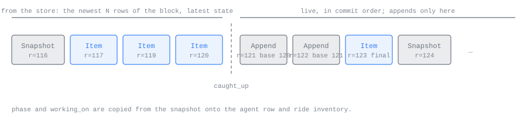
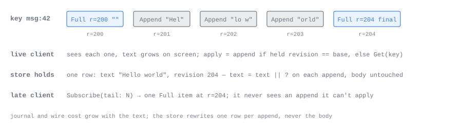
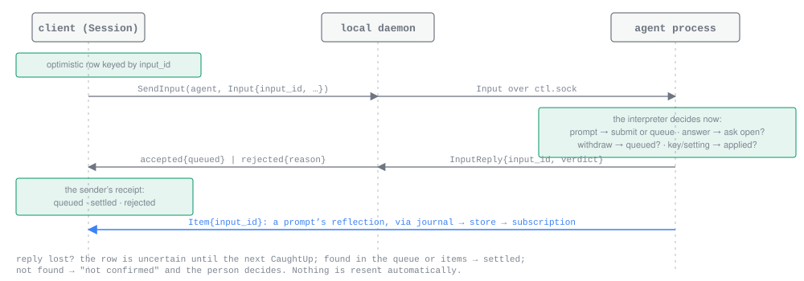

# The wire

*For developers writing a client or changing the amux.v1 service.*

The wire is the protobuf package `amux.v1`, in
[`proto/amux/v1/`](../proto/amux/v1/), with
generated Rust committed under `crates/wire/src/generated/`. This page covers
the client-facing surface: the `AgentService` and `SessionService` calls, the records their streams
carry, how inputs are answered, and the discipline that keeps binaries of
different versions talking. Host-to-host links, pairing and the relay are in
[the protocol](PROTOCOL.md).

| File | Holds |
| --- | --- |
| [`agent_service.proto`](../proto/amux/v1/agent_service.proto) | `AgentService` and its requests: the fleet, agents' lifecycle and messages, blobs, diffs, catalogues, repositories |
| [`session_service.proto`](../proto/amux/v1/session_service.proto) | `SessionService` and its requests: one agent's conversation, `Input` and `SendInputResponse`, the composer's draft |
| [`inventory.proto`](../proto/amux/v1/inventory.proto) | Hosts and agent rows, as the inventory streams them |
| [`records.proto`](../proto/amux/v1/records.proto) | The kind-neutral records: `Step`, `Item`, `Append`, `Snapshot`, `Kind`, `ExitCause`, agent messages, attachments, blobs, diffs, and the streams' `CaughtUp` and `Lagged` |
| [`chat.proto`](../proto/amux/v1/chat.proto) | What the kinds share inside a body: item bodies, snapshot pieces, asks, input and answer pieces, the catalogue |
| [`claude.proto`](../proto/amux/v1/claude.proto), [`codex.proto`](../proto/amux/v1/codex.proto) | The per-kind item, snapshot and input bodies |
| [`agent_process.proto`](../proto/amux/v1/agent_process.proto) | The agent spec and what seeds its queue, and the `ctl.sock` and `pty.sock` frames |
| [`error.proto`](../proto/amux/v1/error.proto) | `ErrorReason`, the amux reasons an error's `google.rpc.ErrorInfo` names |
| [`link.proto`](../proto/amux/v1/link.proto), [`pairing_service.proto`](../proto/amux/v1/pairing_service.proto) | Host-to-host link control, and pairing |
| [`installation_service.proto`](../proto/amux/v1/installation_service.proto) | `InstallationService`: the installation and its profiles |
| [`profile_admin_service.proto`](../proto/amux/v1/profile_admin_service.proto) | `ProfileAdminService`: one profile's account, pairing, peers and dump |
| [`dump.proto`](../proto/amux/v1/dump.proto) | The diagnostic dump's request, answer and parts |
| [`amux/dump/session.proto`](../crates/wire/proto/amux/dump/session.proto) | `amux.dump`: a client's session history as a dump carries it, outside the wire's promises |
| [`google/rpc/`](../proto/google/rpc/) | `google.rpc.Status`, `Code` and `ErrorInfo`, vendored from googleapis |

## Where clients call

A client talks only to the runtime of its own profile on its own machine. That
runtime answers every call from its store and reaches other hosts itself; a
client never opens a store and never dials another host.

| Caller | Transport | Service |
| --- | --- | --- |
| Terminal client, CLI, a third-party client | gRPC over the profile's local socket (`PROFILE_SOCKET` in [`crates/node/src/profiles.rs`](../crates/node/src/profiles.rs)) | `AgentService`, `SessionService`, `ProfileAdminService` |
| Phone app | An in-process call into the embedded runtime | The same services, the same implementation |
| An agent's tool server | gRPC over the agent's `tools.sock`; the socket is the caller's identity | `AgentService` and `SessionService`, restricted |
| A paired host's daemon | An application stream on the link | `AgentService` and `SessionService`, answered for a peer |
| Profile and installation management | gRPC over the installation's front-door socket | `InstallationService` |
| A host pairing with this one | A link stream while a pairing window is open | `PairingService` |

The [`client`](../crates/client/src/lib.rs) crate is the one seam both clients
use: `GrpcClient` on the desktop and `InProcess` on the phone implement the
same `Client` trait, so the session and fleet drivers above them are written
once (see [the client](CLIENT.md)).

On `tools.sock` the caller is an agent. It may message other agents and send
input only to its own direct children; input to any other agent is refused
there with `PERMISSION_DENIED`.

Over a link, a paired daemon calls the same `AgentService` and `SessionService`. Replication is a
daemon being a client of its peer. A call on another host's agent arrives at
the local runtime, which forwards it one hop to the owning host. For a peer
the services answer only for their host's own agents and never pass a call on:
the inventory stream carries that host's entry and agents, and every call
that names an agent it only replicates (reads, input, lifecycle, blobs and
diffs) is `NOT_FOUND`. Only a peer's `SubscribeSession` may carry a cursor,
and only a peer's `SendMessage` envelope names its sender; `ResolveAgent` and
the drafts are refused to a peer.

### Errors

Every refusal is a `google.rpc.Status` (a gRPC code, a message and details
packed as `Any`), gRPC's richer error model, encoded in the gRPC status
details. `client::RpcError` decodes it: `Refused` when the runtime answered
with an error, `Transport` when the connection failed and whether the call
took effect is unknown. Where the code alone does not say what happened, a
`google.rpc.ErrorInfo` detail names an amux reason (domain `amux.sh`, reason
an `ErrorReason` value's name without its prefix). Codes and reasons a client
meets often:

| Code | When |
| --- | --- |
| `NOT_FOUND` | No agent with that id or name, no item with that key, no blob with that hash |
| `FAILED_PRECONDITION` | An ambiguous name; the message offers the forms that pick each candidate |
| `FAILED_PRECONDITION`, reason `HOST_UNREACHABLE` | Older history lives on a host that cannot be reached, and nothing is held locally; a forwarded call that never left |
| `PERMISSION_DENIED`, reason `PAYMENT_REQUIRED` | A forwarded call to a host only the relay reaches, on an account whose subscription lapsed to the free plan; a stop is answered `HOST_UNREACHABLE` in the same words instead, so clients hold it |
| `RESOURCE_EXHAUSTED` | An attachment over the 64 MB limit |
| `ABORTED` | The input was handed to the agent and its answer was lost |
| `PERMISSION_DENIED` | An agent caller sent input to, or stopped, an agent that is not its own direct child |
| `RESOURCE_EXHAUSTED` | A blob could not be written, most often a full disk |

A link refused for another protocol version reads as `FAILED_PRECONDITION`,
reason `VERSION_MISMATCH`; see [Versions](#versions).

## The calls

`service AgentService` in [`agent_service.proto`](../proto/amux/v1/agent_service.proto):

| Call | Returns | Meaning |
| --- | --- | --- |
| `SubscribeInventory(Empty)` | stream of `InventoryEvent` | Hosts and agent rows: the current set, `CaughtUp`, then changes |
| `ResolveAgent(ResolveAgentRequest)` | `Agent` | Fleet-wide reference to row: an id in any form amux prints (with or without dashes, or the short id's eight or more leading hex digits), a name, or `name@host`. Names are unique on a host, so `name@host` picks one; a bare name matching agents on two hosts is ambiguous, and the message offers those forms. Every other call takes an agent id. |
| `CreateAgent(CreateAgentRequest)` | `Agent` | Spawn, optionally with a first prompt (see [Creating and resuming](#creating-and-resuming)). Names are unique on a host, counting exited agents: a given name another agent on the host holds gets the next free suffix (`worker-2`), and the returned `Agent` says the name it got. Without a name the daemon gives a word pair (`quiet-otter`) that no other agent on the host and no branch in the folder's repository has. With `new_worktree` the agent's host first makes a worktree on a branch named after the agent, and the agent starts there |
| `RenameAgent` | `Agent` | A name outside the rule (lowercase letters, digits and hyphens, starting with a letter or digit, at most 64) is refused `INVALID_ARGUMENT`, as it is for `CreateAgent`; a name another agent on the host holds, exited ones included, is refused `ALREADY_EXISTS` saying so. The agent's branch keeps the name it was made with |
| `StopAgent(StopAgentRequest)` | `Empty` | Ends the agent now: its running turn is cancelled the provider's own way and it exits, resumable. There is no "stop when done". The terminal, the phone and an agent's stop tool all call it; the interrupt input is what ends only the turn. Its children follow on their own hosts by [the family rule](PROTOCOL.md#the-family-rule) |
| `ResumeAgent(ResumeAgentRequest)` | `Agent` | Start the agent's directory again, optionally with a first prompt |
| `DeleteAgent` | `Empty` | Stops the agent if live and removes it for good. Its children follow on their own hosts by [the family rule](PROTOCOL.md#the-family-rule) |
| `SendMessage(Envelope)` | `SendMessageResponse` | Agent messaging: who it is from is the caller, never the request (see [Messages](#messages) and [agent tools](AGENT_TOOLS.md)) |
| `PutBlob(PutBlobRequest)` | `BlobRef` | Bytes into an agent's directory |
| `GetBlob(GetBlobRequest)` | `GetBlobResponse` | Bytes out |
| `GetDiff(GetDiffRequest)` | `Diff` | The changed files on the owning host; the patch, stored as a blob, only when asked |
| `GetCatalogue(GetCatalogueRequest)` | `GetCatalogueResponse` | What a provider on a host offers with no agent running: the encoded `Catalogue` and its hash. An agent's catalogue is a blob, read with `GetBlob` |
| `ListRepositories` | `ListRepositoriesResponse` | Repositories a host offers to spawn agents in |

`service SessionService` in [`session_service.proto`](../proto/amux/v1/session_service.proto):

| Call | Returns | Meaning |
| --- | --- | --- |
| `SubscribeSession(SubscribeSessionRequest)` | stream of `SessionEvent` | One agent: opening, snapshot, tail, then live |
| `ListItems(ListItemsRequest)` | `ListItemsResponse` | A page of older items |
| `GetItem(GetItemRequest)` | `Item` | One item in full |
| `SendInput(SendInputRequest)` | `SendInputResponse` | The interpreter's verdict on one input |
| `UpdateDraft(UpdateDraftRequest)` | `Draft` | Keeps the unsent draft of an agent's composer on this machine, for its clients; an empty draft forgets it. Never synced to other machines |
| `GetDraft(GetDraftRequest)` | `Draft` | The draft this machine keeps for an agent |

A debug bundle is `ProfileAdminService.Dump(DumpRequest)`, answered with where it was written; it carries the asking client's open chats for the daemon to redact and write in, and the `scope` of what it holds (see [debugging](DEBUGGING.md)). `SubmitReport(SubmitReportRequest)` writes a person's report around such a bundle and sends it to the profile's account. Both are served only on the profile's socket, never on an agent's.

There are no unary list calls: a listing is `SubscribeInventory` read to
`CaughtUp`. There is no status call: what an agent is working on is a field of
its snapshot.

### Creating and resuming

```proto
message CreateAgentRequest {
  bytes agent_id = 1;
  optional HostRef host = 2;                  // absent: this host
  optional string name = 3;
  optional AgentRef parent = 4;
  string cwd = 5;
  oneof agent {                               // the kind, with its settings
    ClaudeCreateConfig claude_pty = 6;
    ClaudeCreateConfig claude_sdk = 7;
    CodexCreateConfig codex = 8;
  }
  optional PromptSubmission initial_prompt = 9;
  bool new_worktree = 10;
}

message HostRef { oneof of { bytes host_id = 1; string name = 2; } }
message PromptSubmission { bytes input_id = 1; PromptInput prompt = 2; }
message ResumeAgentRequest { bytes agent_id = 1; optional PromptSubmission initial_prompt = 2; }
```

`host` names the host that runs the agent, by id or by the name a person
knows it by, resolved against this host and the trusted ones: exact first,
then ignoring case. A name more than one host answers to is refused
`FAILED_PRECONDITION`. A host runs only the kinds its handshake
announces (`Capabilities.kinds`; a phone announces none): a create naming a
kind its host does not run is refused `FAILED_PRECONDITION` in words ("phone
runs no agents"), by the near daemon before forwarding and by the host
itself. The `agent` arm is the kind: both Claude
kinds take `ClaudeCreateConfig` and Codex takes `CodexCreateConfig`, so the
settings are always the kind's own. A create with no arm set names no
interpreter and fails with `INVALID_ARGUMENT`. `initial_prompt` is a prompt with its attachments and the client's
input id; it is queued before the agent starts. A resume takes the same: the
exited chat's composer sends its draft that way.

## Subscribe

```proto
message SubscribeSessionRequest {
  bytes agent_id = 1;
  oneof from { uint32 tail = 2; After after = 3; }
}
```

A client sends one integer, `tail`: how many of the newest rows it wants. It
never sends a revision. The runtime caps the tail at K, the rows a replica
keeps (200, `Settings.tail_rows` in [`crates/daemon-core/src/io.rs`](../crates/daemon-core/src/io.rs)).
The tail is a minimum: a client that cannot fill its screen pages older at once
with `ListItems`. Only a paired daemon sends `after`: it is how a
peer's source resumes toward an origin, with the revision it holds, a cap, and
the origin generation that revision was taken under.

A stream is `SessionEvent`s:

| Event | Meaning |
| --- | --- |
| `Opening` | The origin generation the stream's rows belong to. Always first; a client that reopens under another generation than its last `Opening` or `Reset` named rebuilds as at a `Reset`. |
| `Snapshot` | Everything needed to draw the agent without items. Second. |
| `Item` | One item, full state at its revision |
| `Append` | Text added to an item the client holds |
| `CaughtUp` | You hold what the origin holds as of now |
| `Detached` | The origin is not being followed; rows may be stale |
| `Reset` | Forget the transcript; a fresh tail of the block under its `generation` follows, then `CaughtUp` |
| `Lagged` | This stream fell behind and closes after this event; subscribe again |

### What a stream carries

1. **The opening**, read from the runtime's store in one cut: `Opening`,
   the snapshot, then the newest `tail` rows of the agent's block by order,
   oldest first, each once in its latest state, then the agent's marker if
   one is set (`CaughtUp`, or `Detached` for a replica nobody is
   following).
2. **Live events**, forwarded verbatim in commit order: every `Snapshot`,
   `Item` and `Append` committed after the cut, and the markers as they come.



An agent whose interpreter has not written a snapshot yet opens with a
`Snapshot` holding only the kind tag and an empty body, which every per-kind
decoder renders as "starting, nothing known yet".

The profile's core reads the cut and registers the stream in one step
(`daemon_core::serve`), and every commit is a step of the same core that
publishes as it commits, so every record is either in the opening or arrives
live, and the marker describes the same point as the rows beside it.
A client still absorbs by key and ignores an equal or older revision, so an
overlap would be harmless.


### Markers

`CaughtUp` means one thing on every stream: you hold what the origin holds as
of now.

- For an agent this host runs, it comes the first time ingest reaches the end
  of the agent's journal after each connection from the agent, not when the
  stream opens. After a daemon restart with a backlog, a chat sees the rows
  flow in and then the marker. An agent found exited at startup gets its marker
  once its journal remainder is ingested.
- For a replica, the runtime forwards the origin's `CaughtUp` and never mints
  its own. It can arrive after live items, and arrives again after every
  reconnect to the origin. Its `revision` is what a peer source stores as its
  cursor; clients ignore it.

`Detached` follows the held rows at once when the agent's host is away, and is
sent whenever the runtime's source for that agent loses its stream. The rows
are served as they stand, stale and honestly, until the source reconnects and
`CaughtUp` arrives.

`Reset` comes from a replica's source when the origin answered with a fresh
tail rather than a delta: the source's cursor was too far behind for the
cap, or was taken under a generation the origin no longer runs (an unclean
reboot mints the same revisions again for different content). A replica's
first catch-up is one too: it takes a tail into an empty block. `Reset` names
the generation the fresh block belongs to, so a client whose stream opened
under the old block, or under none (`0`, a replica no source had caught up
yet), holds the new generation from here and a later reopen under it
continues the window. The client keeps drawing what it has, builds the fresh
transcript beside it, and swaps it in at the next `CaughtUp`.

`Opening` carries the origin's generation: its own for an agent the host
runs, and for a replica the one its source last caught up under. A peer
source stores it beside its cursor and sends both back in `after`. A client
resumes with a tail, and needs it only to notice a `Reset` it missed: a
stream that lagged or dropped may have carried one, so a reopened stream
under another generation than the window was built under is treated as a
`Reset`, built apart and swapped in at `CaughtUp`.

`Lagged` means the stream fell more than the fan-out ring's capacity behind
the agent's broadcast. The stream closes; the client subscribes again with a
tail, the same way it arrived. The runtime never buffers for a slow reader: the
store is where late arrivers catch up.

The stream never ends for host reasons. It ends after `Lagged`, when the agent
is deleted, and when the runtime stops listing the agent; a client then
returns to the fleet.

## Records

The records are defined once in
[`records.proto`](../proto/amux/v1/records.proto), and the bodies
the kinds share in [`chat.proto`](../proto/amux/v1/chat.proto). The
journal frames them, the store keeps them and every stream carries them.

### The envelope

```proto
message Item {
  string key = 2;             // from the interpreter
  uint64 order = 3;           // assigned once per key by the owning daemon
  uint64 revision = 4;        // assigned on every upsert by the owning daemon
  bytes input_id = 6;         // on a prompt's reflection and an agent message
  string text = 7;            // the one appendable field
  repeated Attachment attachments = 8;
  Kind kind = 9;              // which per-kind item `body` holds
  bytes body = 10;            // the per-kind item, encoded
  int64 at_ms = 11;           // when it happened
}
```

`Snapshot` carries the same split: kind-neutral envelope fields (`revision`,
the `queue` of `QueuedInput`s, `phase`, `working_on`, `at_ms`,
`phase_since_ms`, `git`, `background_jobs`) and a per-kind `body`.
`background_jobs` is how many jobs the body's background list holds (zero
while it is unknown), so the daemon can put the count on the inventory row
without decoding the body. `Phase` is `PHASE_STARTING`,
`PHASE_IDLE`, `PHASE_WORKING` or `PHASE_NEEDS_YOU`.

`phase_since_ms` is the interpreter's clock when `phase` last changed. The
part every interpreter shares stamps it, so streamed output and other changes
within one phase leave it alone; it is what a row's "working for 3m" or "idle
since 10:42" counts from. `git` is the branch, base branch and change totals
of the agent's folder, absent outside a repository:

```proto
message Git {
  optional string branch = 1;          // absent on a detached head
  optional string base_branch = 2;     // the branch amux made the worktree from, else the default
  optional ChangeTotals uncommitted = 3;  // working tree against HEAD
  optional ChangeTotals on_branch = 4;    // from where the branch left its base to the working tree
}
message ChangeTotals { uint32 files = 1; uint32 added = 2; uint32 removed = 3; }
```

On the base branch itself the branch has left nothing behind, so `on_branch`
equals `uncommitted`; it is absent only without a base or a commit, or when
the branch shares no history with its base.

The daemon and the store read only the envelope. A `body` is bytes to them,
stored and forwarded without decoding, so a body written by a later agent
binary passes through an earlier daemon intact. Bodies are decoded only at the
two ends: the interpreter that wrote them and the client's per-kind layer. The
`kind` tag says which message a body holds (`ClaudeItem` for both Claude
kinds, `CodexItem`, and the matching snapshots), as a `Kind`. A kind the reader has
no name for is still a number it keeps: a replica of an agent of a newer kind
is listed with that kind, and its items carry it. The item vocabulary itself is
described in [the chat vocabulary](CHAT_VOCABULARY.md) and
[interpreters](INTERPRETERS.md).

A snapshot is sufficient on its own. Phase, open asks, queue, model and mode
live in it, so a client holding a snapshot and no items still renders the agent
correctly, and every change to that state arrives as a later snapshot on the
same stream. Every field of a snapshot body is present in every snapshot, at an
explicit unknown value until the interpreter learns it.

### The rules

- An item is full state at its revision. There are no deletes. An older
  revision never overwrites a newer one, in the store or in a client.
- `order` places an item in the transcript and never changes; `revision`
  orders versions. Clients sort by order and merge by key.
- Durations are differences of two `at_ms` values ("Thought for 8s",
  "Worked 1m 42s"); no body carries a duration.
- A prompt yields exactly one item carrying its `input_id`: the provider's
  reflection of it. Every other input is answered by the `SendInput` reply and
  shows in the next snapshot. There are no rejection items.

### Appends

Exactly one field is appendable: `Item.text`.

```proto
message Append { string key = 2; uint64 base_revision = 3; uint64 revision = 4;
                 string text = 5; }
```

A client applies an append when the item it holds for `key` is at
`base_revision`: it adds `text` and takes `revision`. If it holds a newer
revision it ignores the append. If it holds an older revision it calls `GetItem`
for the item. If it holds nothing for the key it drops the append. Appends are
only sent live, never in an opening, and every stream of appends ends with a
full item, so a client that subscribes late receives the full item and never
an append it cannot apply.

Dropping is safe because the stream sends an item before any append to it, so
a client that holds nothing for a key has let the item go: it is below the
window the client keeps, or behind a reload it is waiting for. Whenever the
client reads that row again (a page, a reload) the store gives it whole.
Appends go to any item still open, not only the newest, so fetching instead
would cost a client with a small window a `GetItem` for every running command
below it.



## Paging: Fetch and Get

```proto
message ListItemsRequest  { bytes agent_id = 1; optional uint64 before_order = 2; uint32 page_size = 3; }
message ListItemsResponse { repeated Item items = 1; bool exhausted = 2; }
```

`ListItems` returns items by order, newest first, strictly below `before_order`,
or the newest `page_size` items when it is absent. `exhausted` means no older
history exists anywhere. A page is capped at 500 items (`MAX_PAGE` in
[`crates/node/src/serve.rs`](../crates/node/src/serve.rs)); a client asks
again below the oldest item it got.

`ListItems` is a store read and never touches the agent. For a paired host's agent
the part of a page below what this machine holds comes from the origin and is
kept for next time. An origin that cannot be reached is an error
(reason `HOST_UNREACHABLE`) when nothing is held, never an empty page; when some rows are
held they are returned with `exhausted` false, and the next page asks again.

`GetItem(agent_id, key)` returns one held item in full. It is how a client
recovers when an append's base does not match the revision it holds.

## Messages

`SendMessage` takes an `Envelope`: a message to an agent, on this host or
another, its `id` the caller's for dedupe. The daemon stamps who it is from:
the person on a client socket, the agent whose tools socket made the call.
The `from` a client fills is overwritten, so no caller can speak for anyone
else; only a paired daemon's envelope keeps the sender it stamped.

```proto
message Envelope {
  bytes id = 1;
  optional bytes context = 2;
  Sender from = 3;              // stamped by the sending daemon
  AgentRef to = 4;
  oneof body {
    MessageBody message = 5;    // text, attachments
    ChildReport report = 6;
  }
}

message ChildReport {
  uint32 to_incarnation = 1;    // the parent's incarnation it is for
  uint32 from_incarnation = 2;  // the child's own
  oneof end {
    TurnEnded turn_ended = 3;   // text, outcome, last
    Exited exited = 4;          // ended
  }
}
```

The daemon carries a message, and a child's report to its parent, in one
`Envelope`: it goes where a message goes (`SendMessage` between hosts, the
agent's `agent_message` frame, a resumed agent's bootstrap), is deduped by
`id` and routed by `to`, and only its body differs. A message's body is its
text and its `attachments`, which reference blobs in the sender's directory on
the sender's host as the request gave them. Reports are the daemon's own,
sent when a child's turn or incarnation ends, and cannot be submitted: a
client's envelope with a report is refused `INVALID_ARGUMENT`. A report names the parent incarnation it
is for (`to_incarnation`; the recipient's daemon drops it for any other) and
the child incarnation it is from (`from_incarnation`). Its end is one of two:

- `TurnEnded`: the child's turn ended. Its `text` is the child's last
  message, its `outcome` how the turn ended (a `TurnOutcome`: completed,
  interrupted, stopped or failed), taken from the step's `TurnEnd`, and its
  `last` says the turn was the incarnation's last (the step's `TurnEnd` was
  marked `last`: the child exits after that turn).
- `Exited`: the child's incarnation ended without a turn end marked last
  (its turn open, or ended idle, as a stopped subagent waiting on its own
  child is). It carries how as `ended` (an `IncarnationEnd`: the `ExitCause`
  and its own words), which the parent's interpreter words for its provider,
  and it is always the incarnation's last report.

Each child incarnation ends with exactly one last report. A subagent waiting
on its children waits for each incarnation's last report, matching reports to
incarnations by `from_incarnation`, so it does not matter whether a report or
its daemon's word that the incarnation is live comes first. The recipient's
daemon dedupes by `id` against the recipient's items, so a resend after a lost
answer is one message. The answer comes once the recipient has accepted it. A
paired host forwards the envelope its daemon stamped, and the receiving
daemon takes that sender as given.

A received envelope becomes an `AgentMessage` item in the recipient's
transcript, whose `EnvelopeKind` says what its body was: `MESSAGE`, `FINISHED`
for a turn report and `FAILED` for an exit report.

## Inputs

```proto
message SendInputRequest { bytes agent_id = 1; Input input = 2; }

message Input {
  bytes input_id = 1;                    // generated by the client
  bytes body = 2;                        // an AgentInput, encoded
}
```

A client sends semantic inputs, one `AgentInput` oneof for every kind: a prompt, an answer to an
open ask, a withdrawal or send-now of a queued prompt, an interrupt, a model,
effort, permission or mode setting, and for terminal Claude its
permission-mode cycle, the one keystroke a remote client sends, and
`SwitchBack`, which returns Claude's own view to this agent's conversation
after it switched to another (refused as unsupported until terminal Claude
notices such a switch). Raw terminal
bytes never cross the wire; anything else in Claude's terminal is typed at the
machine, and a dialog amux cannot answer is left by stopping the agent or
attaching there. A kind refuses an arm it does not take `REFUSAL_UNSUPPORTED`:
terminal Claude takes no settings but its cycle, headless Claude and Codex no
keystrokes, and only Codex takes a mode. `AgentInput` and its one `Answer`
(the key of the ask it answers, and an arm per answer shape: Claude's
permission answer, Codex's approval and grant, and the question, plan, form,
link and reply-instead answers both kinds share) are in
`session_service.proto`. A Codex approval is an `Answer` whose decision must
be one the ask offered.

The body is the `AgentInput` encoded, and it crosses daemons as bytes: a
daemon forwarding an input to a paired host, or handing it to the agent,
never decodes and re-encodes it, so an arm or field this daemon does not know
reaches a newer agent intact. Only the agent decides it. The
daemon reads a copy for its analytics and passes on an input whose copy it
cannot read.

An `Input` is only ever a person's. What else reaches an agent comes from its
own daemon over `ctl.sock`: an agent message with the envelope the daemon
stamped, a dump request, and a Codex agent's new name (see
[AGENT_PROCESS.md](AGENT_PROCESS.md#the-control-socket)). On an agent's tools
socket input goes only to the caller's own children, and the input an agent
sends is the stop tool's interrupt.

### The verdict

The runtime hands the input to the agent over its control socket, and the
interpreter answers at once:

```proto
message SendInputResponse { oneof of { Accepted accepted = 1; Rejected rejected = 2; } }
message Accepted { bool queued = 1; }
message Rejected { Refusal refusal = 1; optional string detail = 2; }
```

The reply is the interpreter's verdict, not a receipt for a handover. A prompt
is submitted or queued; an answer's ask is open or closed; a withdrawal's
target is queued or not; a setting or the mode cycle is applied or
unsupported.



The agent sends the verdict only after the step that explains it is in its
journal, and it nudges the daemon before it replies. The daemon ingests on
each nudge before it reads the next frame from the agent, so by the time a
`SendInput` reply reaches the client, the snapshot that lists a queued prompt
has already been committed and broadcast.

The `Refusal` says why:

| Refusal | Given by | When |
| --- | --- | --- |
| `REFUSAL_CLOSED_ASK` | interpreter | The answer names an ask that is not open, for example one already answered on another device |
| `REFUSAL_NOT_QUEUED` | interpreter | The withdrawal or send-now names an input that is not waiting in the queue |
| `REFUSAL_UNSUPPORTED` | interpreter | This agent version, kind or state cannot take the input, or send-now with no turn running |
| `REFUSAL_DRAINING` | the agent | The agent is finishing up because its daemon went away or it was stopped |
| `REFUSAL_EXITING` | the agent | A one-shot child decided to exit |
| `REFUSAL_EXITED` | the owning daemon | The agent has exited; the composer offers Resume |
| `REFUSAL_HOST_UNREACHABLE` | the local runtime | The agent's host cannot be reached, so the input never left; one that left and lost its answer is `ABORTED` instead |
| `REFUSAL_CONVERSATION_ELSEWHERE` | interpreter | Terminal Claude's own view switched to another conversation, so a prompt would land in a conversation that is not this agent's |
| `REFUSAL_TOO_LONG` | interpreter | The prompt is longer than the agent takes: Codex takes at most 1,048,576 characters (2^20), and would refuse a longer one only after amux had taken it; the detail names the limit and the prompt's length |

`detail` carries a sentence for a person when the refusal depends on the
provider rather than the protocol. A client shows the
detail when there is one and its own words for the refusal otherwise; a
refusal it has no words for reads as a plain refusal.

### States a client observes

| State | Observed when |
| --- | --- |
| sent | `SendInput` is in flight. The optimistic row exists. |
| queued | The reply was `accepted { queued: true }`; every snapshot lists the input id in its `queue` until it is submitted. |
| settled | The reply was `accepted`, and for a prompt an item carries the input id. |
| rejected | The reply was `rejected`, carrying its `Refusal` and any `detail`. |
| uncertain | The connection dropped before a reply, or the runtime answered `ABORTED`. Shown as "not confirmed". |

An uncertain input is judged only at the next `CaughtUp`: found in the
snapshot's queue it is queued, found as an item it is settled. Otherwise it
stays uncertain and the client offers resend and discard. Nothing is resent
automatically, because absence is not proof: another client may have withdrawn
the prompt, a completed prompt may sit outside the held tail, and an exited
agent may have received it. A resend is a fresh input with a fresh id. The
state machine is `SessionState` in
[`crates/ui-state/src/session.rs`](../crates/ui-state/src/session.rs).

The queue lives in the interpreter, not in the provider. A second client's
prompt lands in the same queue, and every client sees it in the snapshot.
Editing a queued prompt is `WithdrawQueued` followed by a fresh prompt; nothing
is edited in place. `SendQueuedNow` delivers one queued prompt into the running
turn through the provider's own steering path.

## Blobs and diffs

```proto
message PutBlobRequest  { bytes agent_id = 1; string name = 2; string mime = 3; bytes bytes = 4; }
message GetBlobRequest  { bytes agent_id = 1; bytes hash = 2; }
message GetBlobResponse { bytes bytes = 1; }
message BlobRef         { bytes hash = 1; string name = 2; string mime = 3; uint64 size = 4; }
```

`PutBlob` writes a person's attachment into the named agent's directory on the
agent's own host, named by its SHA-256, and returns the `BlobRef`. An
attachment is at most `wire::ATTACHMENT_SIZE_LIMIT` (64 MiB, which clients
word "64 MB") of its own bytes; `wire::CHANNEL_MESSAGE_SIZE_LIMIT`, the cap
on any one RPC message, is 1 MiB above it so a file at the limit still fits
in one `PutBlobRequest` with its framing. Clients check the limit before
uploading; the daemon refuses a larger one `RESOURCE_EXHAUSTED` in words
naming the limit ("big.bin is … bytes, over the 64 MB limit for an
attachment"), before forwarding it anywhere. The client
then sends the input whose `Attachment` carries that reference. The same bytes
twice are one file. Only a person can call it; an agent writes its own blobs
directly into its directory.

`GetBlob` reads the bytes by agent and hash and answers the bytes alone: the
caller named the hash, and the name and mime type belong to the attachment
that referenced the blob. For a paired host's agent the local runtime reads its
replica copy, or fetches the bytes from the origin, checks their hash, keeps
them under `replicas/` exactly as the origin sent them and returns them.

`GetDiff(agent_id, base, with_patch)` compares the agent's working directory on
its own host, through the `git-facts` crate the agent process also reads its
row's totals with. It runs to the working tree, untracked files included, from
HEAD for the `head` base, or from where the branch left the named base
branch for a branch base, so the branch's commits and its uncommitted work both
count. The `Diff` value carries the base, `head` (empty before the first
commit), the `merge_base` for a branch base, and `files`: each changed file's
path, lines added and removed, whether it was created, deleted or changed, and
whether it is binary. Only `with_patch` builds the patch and stores it as one of
that agent's blobs (`text/x-diff`), named in `patch`; without it the host writes
nothing. An exited agent's folder is compared as it is now; another host's
agent's diff is made on that host and forwarded.

What an agent offers to pick from (the models, commands, permissions and modes)
is a `Catalogue` its agent process writes as a blob of its directory, before
the step whose snapshot names it. `Snapshot.catalogue` is the blob's hash, the
SHA-256 of exactly the bytes written, so identical catalogues are one. A
client reads it with `GetBlob(agent_id, snapshot.catalogue)`, decodes it and
keeps it under the hash it asked for, once per hash. Because the bytes are
never re-encoded on the way, a catalogue written by a newer agent passes
through a daemon that does not know all its fields with its hash intact. For a
paired host's agent the replica's copy is a blob like any other, kept while
the replica's current snapshot names it (see [attachments](ATTACHMENTS.md)),
so the picker still reads with the origin away. A hash that names no blob is
`NOT_FOUND`.

`GetCatalogue(host_id, provider)` names a host and a `Provider`
(`PROVIDER_CLAUDE` or `PROVIDER_CODEX`) and answers what that provider offers there with no agent running,
as a `GetCatalogueResponse`: the encoded `Catalogue` and the SHA-256 of exactly
those bytes, which is the hash the host's entry names for that provider. The
daemon holds no provider code: it runs the hidden helper `amux internal catalogue <provider>`, which
starts the provider just long enough to ask what it offers and whether it is
signed in, and keeps the answer per provider under the profile's `providers/`
folder. It asks again when the copy is half an hour old, when the provider's
`--version` prints something new (read at most once a minute), and for a copy
that says signed out once a minute has passed. Both Claude kinds share
Claude's copy; terminal Claude, which offers nothing a program can read,
offers its host's Claude models and commands. A paired host's providers are
asked on that host. A helper that fails answers with the copy when there is
one, else `UNAVAILABLE`; an unknown provider is `INVALID_ARGUMENT`.

A blob lives as long as its agent's directory. See
[attachments](ATTACHMENTS.md) for the attachment types and lifetimes.

## Inventory

`SubscribeInventory` streams `InventoryEvent`s: `HostEntry` for every trusted
host and every discovered candidate, `Agent` for every agent row the runtime
holds (its own and its paired hosts'), then `CaughtUp`, then changes as they
happen (`HostEntry`, `HostRemoved`, `Agent`, `AgentRemoved`). A paired host's
stream of it carries only the answering host's own entry and agents.

A reader that falls more than the inventory ring's capacity behind is sent
`Lagged`, and the stream closes. The reader subscribes again at once, with no
backoff, since nothing is wrong with the connection, and reconciles against
the fresh listing: what that listing no longer names at its `CaughtUp` is
gone. A stream that ends without `Lagged` is an outage, and the reader backs
off between attempts. A paired host following this host's inventory does the
same: on `Lagged` it follows again under the same session, and its sources
for that host's agents keep running.

`Agent` is the inventory row. It carries `kind`, `name` (always set),
`cwd`, `parent` (a host and an id, since families cross hosts), `lifecycle`
with `exit_cause` and `exit_detail`, `phase`, `working_on`, `phase_since_ms`
(on the origin host's clock; the row's creation time until its first
snapshot) and `git` copied from the agent's newest snapshot envelope,
`incarnation`, and two counts of what a stop or delete would cut:
`background_jobs`, copied from the snapshot envelope, and `descendants`, the
live agents below it. The agent's own host counts `descendants` over the rows
it holds, walking into its own agents and taking each paired host's agent's
own count for what lies below it, so the count reaches every host that host
knows of; it is best effort, and a host out of reach may be undercounted. A
replica row carries its origin's count. It never carries a snapshot: a client
reads an agent's conversation from the agent's own session, which the client
library keeps open for every live agent (see [the client
library](CLIENT.md#the-fleet)), so the row stays small.

`exit_cause` is an `ExitCause`, and `exit_detail` the cause's own words when it
has any (a provider's exit code, why a provider could not start). Most causes
are the agent's own, written in its journal as the last step's
`incarnation_end` (see [the agent process](AGENT_PROCESS.md#lifecycle)):
`FINISHED` (a child's one-shot exit), `STOPPED` (a stop: its turn cancelled the
provider's own way, then the exit), `PROVIDER_EXITED`,
`DAEMON_LOST`, `ORPHANED`, `COULD_NOT_START` and `DIRECTORY_FAILED`. The
daemon copies that onto the row when it ingests the step, reads the journal
to its end before it marks the agent exited, and records its own cause only
where the journal has none: `COULD_NOT_START` when the agent process cannot
be spawned, `DIRECTORY_FAILED` when the agent's directory is gone, `KILLED`
when it killed the process (a stop that overran its deadline, or a runtime
being torn down), `ENDED_WHILE_AWAY` for a process found dead when
a daemon starts, and `ENDED_UNEXPECTEDLY` otherwise. `UNSPECIFIED` is a live
agent's (a row still live can briefly hold the cause its journal ended with,
until the daemon marks it exited, so a client reads the cause only on an
exited row), and a cause a client does not know reads as an ordinary end,
not a failure: clients draw `FINISHED` as finished,
the stops and unknown causes as ended, and every other cause as a failure in
its words followed by its own. The `Boundary` that ends an incarnation in the
journal carries the same cause and detail.

`HostEntry` carries the host's own word (its `Host`: name, version, platform,
capabilities and whether it is signed in), its `generation`, which changes
only after an unclean reboot of that host (see
[the journal and store](JOURNAL_AND_STORE.md)), and its `providers`: per
provider the host has been asked about, the hash of what that provider offers
there and whether it is signed in; a paired host's come from that host's own
entry. Its `standing` is one of two arms. A pairing candidate is `Candidate`,
carrying the addresses discovery found it at and `announced_by`, the
neighbors that announce it, nearest route first, each a `Host` whose
`capabilities.cloud_relay` says whether this machine admitted that link as
the cloud relay (which carries a pairing only for a paid account). A paired host is `Trusted`, whose
`reach` is one of three: `online` once a channel to it has opened on a route
still listed, naming that route; `away` while the relay refuses its channel
because the account's free plan carries no connection between hosts; and
`offline` otherwise, carrying the last dial error and whether the host said it
no longer trusts this machine (`revoked`). `current` says whether this
machine's copy of the host's agents has caught up. A host whose route has just
come up keeps its reach until the first channel on it opens or fails
([presence](PROTOCOL.md#chapter-3-presence)).

`AgentRemoved` says the row left this daemon's view, which is not always
deletion at the origin: a delete or retention here, a paired host that stopped
listing the agent, and every row of a host this machine stopped trusting all
send it. A client subscribed to that agent sees its stream end. A delete stops a live agent first, and nothing of that stop is published:
the agent's row and session say nothing more until `AgentRemoved`, so no client reads
the stop as an exit it could resume.

An inventory stream that falls behind sends `Lagged` and closes; the client
subscribes again at once for a fresh current set. `amux ls`-style one-shot listings read to `CaughtUp`
and close.

## Compatibility

`amux.v1` is the released protocol. From amux 0.9.0 on, paired machines,
long-running agent processes and long-lived clients run different versions at
once, and stores and journals outlive the build that wrote them. So every
surface in `amux.v1` (the client services, the link and pairing
messages, the `ctl.sock` frames and the journal's records) changes by field
discipline alone:

- Fields, oneof arms, enum values, messages and calls are added freely.
- A number is never renumbered, retyped or reused. A field or enum value that
  goes leaves its number `reserved`.
- A field never moves into, out of or between oneofs.
- Names are not on the binary wire and may change, but for two: a service's
  and a method's name, which are its gRPC path, and an error detail
  message's, which is its `Any` type URL. A field or a method may take
  another message that reads the same numbers, as an empty request may grow
  into one with fields.

`just proto-compat`, which CI runs, holds the tree to these rules against the
newest release tag at or after 0.9.0, reading the descriptor set committed
with that release; `just proto-compat <ref>` checks against any other ref. A
break both ends of a link must take is a new `PROTOCOL_VERSION`, not an edit.

What a client writes into a dump is `amux.dump`, outside these promises:
`DumpRequest.sessions` carries each session as bytes, and only the build that
wrote it reads it back.

After any edit to a `.proto`, run `just protobuf` to regenerate the committed
Rust; `just codegen-check`, which CI runs, fails on stale output.

What the design already relies on:

- A body is decoded only by the interpreter that wrote it and by clients, so
  the daemon and store pass bodies through without reading them.
- An input arm an interpreter does not know is answered `Rejected` with
  `REFUSAL_UNSUPPORTED`.
- A phase a client does not know decodes as `PHASE_UNSPECIFIED`, which the
  views draw as idle.

### Versions

`wire::PROTOCOL_VERSION` (in [`crates/wire/src/lib.rs`](../crates/wire/src/lib.rs))
is checked in one place: the link handshake between hosts. A connecting host
names its version in `Hello.protocol_version`; the acceptor refuses a `Hello`
naming another, closing the link with `LINK_CLOSE_REASON_VERSION_MISMATCH`,
which the connecting host reads as the error reason `VERSION_MISMATCH`. It is 1, and moves only for a break
both ends of a link must take.

Nothing else carries a version integer:

- **Local clients** call the client services with no handshake. A client may
  compare its own version with its host's `HostEntry.host.version`; the terminal
  client shows "amux *version* is running · restart to update" when they
  differ.
- **`ctl.sock` and the journal** have no version integer at all.
- **The store** has a schema version; a store of another version is
  refused, by name, and left as it is (see
  [the journal and store](JOURNAL_AND_STORE.md)).

## Writing a client

A checklist for a client against `AgentService` and `SessionService`:

1. Subscribe to the inventory and draw the fleet from `Agent` rows; treat the
   first `CaughtUp` as "the list is complete". On `Lagged`, subscribe again at
   once and drop what the fresh listing no longer names at its `CaughtUp`.
2. To open a chat, `SubscribeSession` with a tail. Draw from the snapshot at once;
   merge items by key, keep the highest revision, sort by order.
3. Apply appends only on a matching base; `GetItem` an item held at another
   revision; drop an append for a key you hold nothing for.
4. On `Reset`, build a fresh transcript and swap it in at `CaughtUp`, and
   hold its generation as the window's. On
   `Lagged`, re-tail at once: subscribe again with a tail. On a dropped
   stream, subscribe again with a tail and back off between attempts.
5. Page older history with `ListItems` below the oldest held order until
   `exhausted`.
6. Give every input a fresh `input_id`, keep an optimistic row, and settle it
   from the verdict, the snapshot's queue and the reflection item. Leave an
   input whose reply was lost uncertain until `CaughtUp`, and let the person
   decide.
7. Upload attachment bytes with `PutBlob` before sending the input that
   references them; fetch bytes lazily with `GetBlob`.
8. Decode bodies with the per-kind messages named by `kind`, and draw an
   unknown kind or arm as a fixed fallback rather than failing.

The shared implementation of all of this is `ui-state`, `ui-runtime` and the
kind-aware layer they use; see [the client](CLIENT.md).
